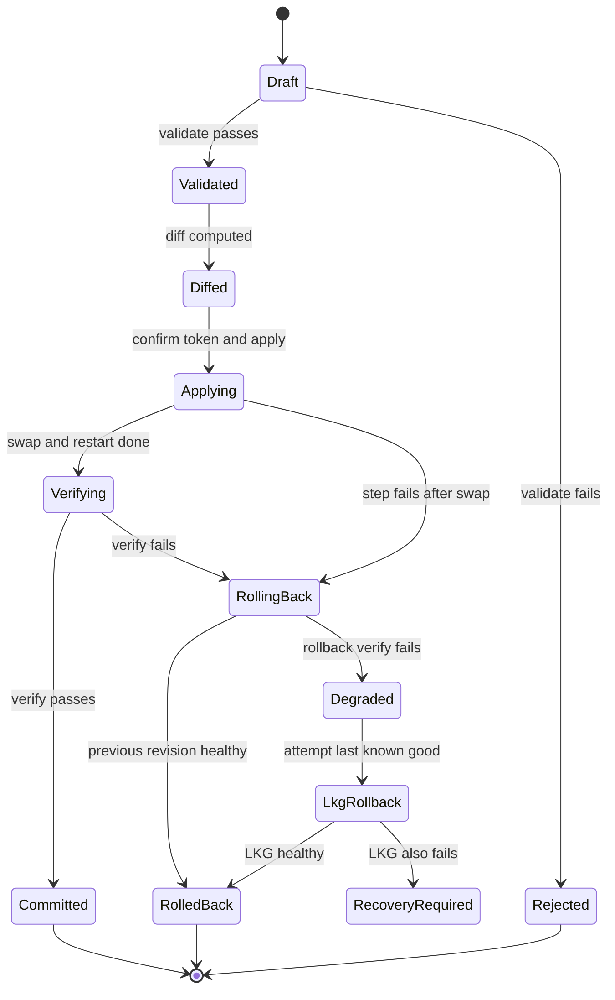
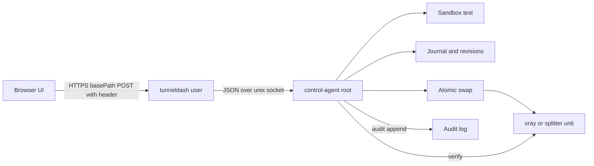

# Dashboard Control Plane Design (TunnelDash write/apply)

Status: DESIGN ONLY (architect subtask of the orchestrator). No code, config, tracked file, or host was changed or contacted. No git commit or push was executed in this session (see section 16).
Branch: feat/multi-carrier-phase2 (tip 88de3eb, as supplied by the orchestrator; not re-verified with git in this session).
Document date: 2026-10-10.
Builds on: [`plans/multi-carrier-intelligence-design.md`](multi-carrier-intelligence-design.md) section 14 (read-only Dashboard v2) and section 15 (Phase 2 staged deployment record).

Evidence labels:
- [V] Verified by reading the file named in the same row or bullet during this session.
- [P] Taken from a plans/ document, not re-read in code during this session.
- [A] Assumption. Must be verified before the phase that depends on it.
- [U] Unverifiable from this repository or session. Listed in section 15.

Line references are to the files as they exist on the branch when read. Paths are relative to this plans/ file.

---

## 1. Executive summary

- The dashboard is read-only today. All of `/api/v2/...` answers GET and HEAD only and any other method returns 405 before a handler runs ([`internal/dashboard/api_v2.go`](../internal/dashboard/api_v2.go:160)). The middleware method whitelist allows only GET, POST, HEAD, OPTIONS, and the mutator is nil, so every apply is refused ([`internal/dashboard/server.go`](../internal/dashboard/server.go:252), [`internal/dashboard/mutator.go`](../internal/dashboard/mutator.go:27)) [V].
- The recommended trust model is option B in section 3: a root-owned, socket-activated helper (`splitterctl control-agent`) that listens on a Unix socket readable only by a dedicated dashboard group, checks the peer with `SO_PEERCRED`, and performs all validation, rendering, swapping, restarting, verifying and rollback. The web process (`tunneldash`) never runs xray, systemctl, or writes under `/etc/split-tunnel`.
- The change lifecycle is draft, validate, diff, apply, verify, auto-rollback, history. Every live write goes through a journaled, locked, idempotent state machine that can be recovered after a crash (section 5).
- Several findings in the current tree must be fixed before any write endpoint ships (section 2.3). The most important: the CSRF origin check is effectively disabled (the server constructs it with an empty expected origin), and under the current user model a dashboard running as `split-tunnel` can read the Reality private keys from the 0640 live config.
- Rollout: C1 read-only validation and diff with fixed CSRF and no disk writes; C2 apply for splitter policy and dashboard theme with auto-rollback; C3 routing and outbound editing (blocked until the routing model is decided, D9); C4 multi-carrier enable and Reality key rotation, which are coordinated two-host changes; C5 hardening and multi-operator. Gates and rollback are in section 12.
- Reality edits that change SNI, port, shortId or keys are peer-coupled: the Iran consumer config holds the same values. They are staged and exported as Blob B until the Iran side has its own agent (C4). Editing them on Germany alone breaks the tunnel.

---

## 2. Current state (verified) and gaps

### 2.1 Dashboard surface

| Area | Current behaviour | Evidence |
|---|---|---|
| Router, v1 and v2 mount | v1 under `/api/v1/...`; v2 under `/api/v2/` handled by `handleV2`; UI at `/` | [`internal/dashboard/server.go`](../internal/dashboard/server.go:94) (94-120) [V] |
| basePath (TLS build) | Whole surface mounted under a random 32-hex prefix; other paths 404 | [`internal/dashboard/server.go`](../internal/dashboard/server.go:128) (128-148) [V] |
| Middleware order | security headers, panic recovery, method whitelist, POST body limit (64 KiB), origin check (POST), auth | [`internal/dashboard/server.go`](../internal/dashboard/server.go:238) (238-298) [V] |
| Origin check | `NewServer` constructs `NewOriginChecker("")`, which disables the check; a POST with no Origin header is also allowed | [`internal/dashboard/server.go`](../internal/dashboard/server.go:82) [V]; [`internal/dashboard/auth.go`](../internal/dashboard/auth.go:118) (118-135) [V] |
| Basic auth | Single fixed user `admin`; PBKDF2-HMAC-SHA256, 210 000 iterations, constant-time compare; verifier at 0640 root:split-tunnel | [`internal/dashboard/basic_auth.go`](../internal/dashboard/basic_auth.go:81) (81, 92, 380-399) [V]; verifier path [`cmd/splitterctl/dashboard_credentials.go`](../cmd/splitterctl/dashboard_credentials.go:69) (69-71) [V] |
| TLS | `ListenAndServeTLS`; minimum version TLS 1.2 | [`internal/dashboard/tls.go`](../internal/dashboard/tls.go:154) (154-197) [V] |
| Bind gate | Non-loopback allowed only with complete TLS config (cert, key, 32-hex basePath) | [`internal/dashboard/tls.go`](../internal/dashboard/tls.go:138) (138-148) [V] |
| Admin token | Deprecated Bearer fallback; when used it becomes the global authenticator | [`internal/dashboard/tls.go`](../internal/dashboard/tls.go:67) [V]; [`cmd/tunneldash/main.go`](../cmd/tunneldash/main.go:218) (218-242) [V] |
| Mutator | Interface with one method; nil default refuses every apply; the comment proposes shelling out to `splitterctl config set` over SSH, which this design rejects | [`internal/dashboard/mutator.go`](../internal/dashboard/mutator.go:19) (9-19) [V] |
| Editing-ready model | `OutboundConfig`, `RoutingRule`, `RoutingPolicy` with pure validators and read-only schemas (`editable=false`) | [`internal/dashboard/api_v2_schema.go`](../internal/dashboard/api_v2_schema.go:63) (63, 74, 84) [V]; validators (91, 113, 150) [V]; `ConceptSchemas` (207) [V] |
| Routing and outbounds in config | Dashboard-only display config (`Outbounds`, `Routing`); no live routing state collected | [`internal/dashboard/types.go`](../internal/dashboard/types.go:198) (198, 201) [V]; [`internal/dashboard/api_v2.go`](../internal/dashboard/api_v2.go:62) [V] |
| In-memory audit | `NewAuditLog(cfg.MaxAudit)` built in main; storage semantics not re-read | [`cmd/tunneldash/main.go`](../cmd/tunneldash/main.go:144) [V] |
| Dashboard config flags | `-read-only`, `DASHBOARD_READONLY=false` exists but has no effect without a real mutator | [`cmd/tunneldash/main.go`](../cmd/tunneldash/main.go:64) (64), (122-124) [V] |

### 2.2 Config, renderers, deploy, systemd

| Area | Current behaviour | Evidence |
|---|---|---|
| Env names | Full list, including multi-carrier and Phase 3 policy knobs (`SPLIT_POLICY_MODE`, `SPLIT_POLICY_TOPK`, `SPLIT_PROBING_ENABLED`, `SPLIT_PROBE_URL`, `SPLIT_PROBE_DAILY_BUDGET`, `SPLIT_TTFB_BASELINE_MS`) | [`internal/config/config.go`](../internal/config/config.go:57) (57-147) [V] |
| Reserved port | 8443 reserved for the dashboard and refused for carrier listeners | [`internal/config/config.go`](../internal/config/config.go:286) [V] |
| Multi-carrier default | OFF; single-carrier form is byte-identical | [`internal/config/config.go`](../internal/config/config.go:229) [V] |
| Germany Reality render | Single inbound 0.0.0.0:443, `dest` derived as SNI:443, `privateKey` written into the JSON, freedom outbound redirecting to 127.0.0.1:9002, routing rule inbound to outbound | [`internal/xray/realityconfig.go`](../internal/xray/realityconfig.go:220) (220-278) [V]; PrivateKey field (172-177) [V] |
| Germany multi render | Second instance on 2053, loopback 9003, distinct tags; validator enforces distinct port, SNI and keypair | [`internal/xray/realityconfig.go`](../internal/xray/realityconfig.go:316) (316-346), [`internal/xray/realityconfig.go`](../internal/xray/realityconfig.go:350) (350-399) [V]; `RenderGermanyMultiConfig` body (lines 401-433) [U] |
| Iran consumer render | dokodemo-door inbound on loopback, VLESS+Reality outbound holding `publicKey`, SNI, shortId, UUID, downHost, downPort; no private key | [`internal/xray/consumerconfig.go`](../internal/xray/consumerconfig.go:167) (167-221) [V]; `RenderConsumerMultiConfig` (398) [V] |
| Live file locations | Germany `/etc/split-tunnel/xray-germany.json` (user `split-tunnel`); Iran `/etc/xray-consumer/config.json` (user `xray-consumer`, root-owned per deploy record) | [`plans/multi-carrier-intelligence-design.md`](multi-carrier-intelligence-design.md) section 15.2 [P]; `User=split-tunnel` for xray-germany [`internal/deploy/state.go`](../internal/deploy/state.go:38) (38-40) [V] |
| Live private keys at rest | Germany live config carries both Reality private keys | [`plans/multi-carrier-intelligence-design.md`](multi-carrier-intelligence-design.md) section 15.7 [P] |
| Single xray process | Instance a (443) and instance b (2053) run in one `xray-germany` service; a restart interrupts both | [`plans/multi-carrier-intelligence-design.md`](multi-carrier-intelligence-design.md) section 15.4 step 1 [P] |
| Transaction engine | Journal written before the first mutation; commit is authoritative and last; failure runs `Recover`; journal retained on recovery failure | [`internal/deploy/transaction.go`](../internal/deploy/transaction.go:83) (83-195) [V]; `fail` (207-217) [V] |
| Journal | 0600, fixed name `journal.json`, containment-checked paths, fail-closed on tamper | [`internal/deploy/journal.go`](../internal/deploy/journal.go:29) (29-42, 93-125) [V] |
| Revisions | Keep last 10 (`maxRevisions`); snapshot per commit; manifest hash in `state.json` | [`internal/deploy/state.go`](../internal/deploy/state.go:23) (23, 107-160) [V] |
| Drift audit | A no-op plan consults `AuditLive`; drift falls through to the full apply and heals the file | [`internal/deploy/transaction.go`](../internal/deploy/transaction.go:107) (107-131) [V] |
| Controller entry points | `ApplyRequest` refuses while a stale journal exists; `Rollback`; `Recover` (journal-driven) | [`internal/deploy/controller.go`](../internal/deploy/controller.go:42) (42-74, 81-93, 149-190) [V] |
| `config set` | Transactional single-key override through `ApplyRequest`; accepted keys include `secret` | [`cmd/splitterctl/main.go`](../cmd/splitterctl/main.go:523) (523-549) [V]; key map (480-498) [V] |
| Unit apply | Byte-exact no-op; candidate `<unit>.tmp-<pid>` swept at preflight; `systemd-analyze verify` on candidate; backup keep 3; post-swap two-case rollback | [`internal/systemd/apply.go`](../internal/systemd/apply.go:58) (58-95, 151-200), [`internal/systemd/apply.go`](../internal/systemd/apply.go:28) (28-32) [V] |
| Health waits | `WaitActive` (250 ms poll, `failed` immediate); `RestartSettle` adds a 500 ms confirm; `HealthCheck` probes `127.0.0.1:<metricsPort>/metrics` with 2 s timeout | [`internal/systemd/health.go`](../internal/systemd/health.go:42) (42-73, 90-119, 125-163) [V] |
| Read-only audit | `AuditStateDir` is read-only by contract; state dir converged to 0750 root:split-tunnel, live configs 0640 | [`internal/systemd/audit.go`](../internal/systemd/audit.go:22) (22-25, 94-146) [V] |
| Rotate credentials | Verifier `/etc/split-tunnel/dashboard/credentials` 0640 root:split-tunnel; recovery file `credentials.recovery` 0600 root:root holds `admin <password>` plaintext at rest | [`cmd/splitterctl/dashboard_credentials.go`](../cmd/splitterctl/dashboard_credentials.go:69) (69-71, 85-138) [V] |
| Repo search for IPC | No SO_PEERCRED, unix-socket server, sudoers or polkit code exists in the Go tree | codebase search, this session [V] |

### 2.3 Findings the design must resolve

- F-1 (CSRF effectively off). `NewServer` sets `ExpectedOrigin` to empty, which disables `OriginChecker`, and a POST with no `Origin` header is accepted. Fix in C1: derive the expected origin from the public host, reject cross-site `Sec-Fetch-Site`, and require a custom header (section 7.1). [V]
- F-2 (basic auth rides cross-site). Browsers may send cached Basic credentials on a cross-site form POST. A custom request header that cannot be set by a plain HTML form, combined with no CORS allow headers, blocks that path. The design relies on this, so the custom header is mandatory, not optional. [A on browser behaviour; verify in UI smoke tests]
- F-3 (web process can read private keys). If `tunneldash` runs as `split-tunnel` (the user brief says so), it is in the group that can read the 0640 live Germany config, which holds the Reality `privateKey` ([`internal/xray/realityconfig.go`](../internal/xray/realityconfig.go:175)). The brief's requirement "key material only on disk, 0600 root" conflicts with xray needing to read the file as `split-tunnel` (section 4.2, decision D3). Resolution: the dashboard runs as its own user and is not in the xray group (D2).
- F-4 (token doc mismatch). The TLS comment says the admin Bearer token gates only mutation endpoints, but the code uses it as the global authenticator ([`internal/dashboard/tls.go`](../internal/dashboard/tls.go:23) vs [`cmd/tunneldash/main.go`](../cmd/tunneldash/main.go:222)). Resolve by removing the Bearer fallback from the control build (C1).
- F-5 (plaintext at rest). The recovery file holds the plaintext admin password at 0600 root:root ([`cmd/splitterctl/dashboard_credentials.go`](../cmd/splitterctl/dashboard_credentials.go:70)). Acceptable for root-only recovery; decision D12 asks whether to delete it after retrieval by default.
- F-6 (`secret` writable through `config set`). `secret` is a settable key ([`cmd/splitterctl/main.go`](../cmd/splitterctl/main.go:495)). The dashboard must never expose it, and the diff must redact it.
- F-7 (deploy drift). A direct file edit by the control plane looks like drift to `AuditLive` and would be healed back on the next converged apply ([`internal/deploy/transaction.go`](../internal/deploy/transaction.go:107)). The control plane must commit through the deploy transaction, or keep its own manifest and tell `AuditLive` about it. Decision D16.
- F-8 (no live routing). Germany and Iran each have one inbound-to-outbound routing rule. The split is done by the splitter, not by xray routing. "Routing rules" therefore need a new model (section 4.6, D9).
- F-9 (shared xray). Both Germany Reality inbounds share one xray process, so an xray restart interrupts both instances. "Min one healthy" cannot be protected by restarting. In-place inbound reload in the pinned xray version is unverified [A/U].
- F-10 (peer coupling). Changing Germany SNI, port, shortId or keys breaks the Iran consumer until Iran is updated. Iran is operator-managed (multi-carrier plan D4 [P]).
- F-11 (Phase 3 knobs). The admission floor, hysteresis margin, dwell time and cooldown are code constants. They are not env keys, so exposing them needs a code change first (section 4.4).

---

## 3. Trust model

### 3.1 Options compared

| Criterion | A: sudo rule for a splitterctl subcommand | B: root socket helper with SO_PEERCRED (chosen) | C: root spool directory plus systemd path unit | D: web process as root | E: polkit action |
|---|---|---|---|---|---|
| Privilege granted to web process | Can run splitterctl as root with arguments; only argv patterns constrain it | Can send fixed JSON operations over a socket; cannot choose a binary, path or shell | Can create files that root parses; any writer to the spool is a root input | Full root | Per-action grant via policy |
| Peer identity | Only the sudoers user name | Kernel-attested pid, uid, gid of the connecting process, plus exe check | None (any process that can write the spool) | Not applicable | Session identity via D-Bus |
| Input surface | argv, and stdin if used; hard to constrain JSON | One framed JSON document, size-capped, schema-checked by the helper | A file, parsed by the helper | Everything | D-Bus message |
| Synchronous result | Yes | Yes (immediate ack with a job id, then polling) | Only by polling a status file | Yes | Yes |
| Failure containment | Sudo misconfiguration becomes root | Helper crash leaves dashboard read-only | Stale files accumulate; path unit retriggers | None | Depends on polkit |
| Repo fit | Uses existing splitterctl | Reuses internal/deploy and internal/systemd; no new dependency | Reuses the same engine | Contradicts the "no root web" rule | No polkit in the repo |
| Verdict | Reject | Choose | Fallback only if sockets are unavailable | Reject | Reject |

Option E is rejected because polkit is not used anywhere in the repo and it would add a daemon dependency for a single service.

### 3.2 Chosen design (option B)

Components:
- `tunneldash`: unprivileged, runs as dedicated user `tunneldash` (D2). It validates the HTTP request and forwards a typed JSON request to the helper. It has no write access to `/etc/split-tunnel`, `/etc/xray-consumer`, `/opt/split-tunnel`, and no sudo.
- `splitterctl control-agent`: a new subcommand of the existing root binary, started by a socket-activated systemd unit. It owns all validation, rendering, sandbox testing, locking, journaling, atomic swap, restart, verification, rollback, revision store and audit log. It reuses `internal/deploy` (journal, store, transaction) and `internal/systemd` (`ApplyExtraUnit`-style core, `WaitActive`, `RestartSettle`, `HealthCheck`).

Socket and identity:
- Path `/run/split-tunnel-ctl/control.sock`, created by systemd's socket unit: owner root, group `tunneldash-ctl`, mode 0660, `Accept=no`. Only members of `tunneldash-ctl` can connect; the dashboard user is the only member.
- On every accepted connection the agent calls `getsockopt(SO_PEERCRED)` (Linux only; guarded by `runtime.GOOS` as in [`internal/systemd/audit.go`](../internal/systemd/audit.go:97)). It requires uid equal to the `tunneldash` user, and it resolves `/proc/<pid>/exe` and requires it to equal the canonical tunneldash binary path. A mismatch is logged and the connection is closed without a response.
- Why the exe check: xray-germany and germany-splitter also run as `split-tunnel` today. A uid-only check is insufficient if any of them is ever placed in the same group. The `/proc/<pid>/exe` check plus the dedicated uid closes that gap. A residual TOCTOU on `/proc` is accepted because the socket group already restricts who can connect [A].

Protocol (v1, newline-delimited JSON, one request per connection):
- Request frame: `{"v":1,"op":"...","reqId":"<uuid>","idempotencyKey":"<opt>","changeId":"<opt>","payload":{...}}`. Maximum 16 KiB. Unknown fields rejected with `DisallowUnknownFields`.
- Ops: `draft`, `validate`, `diff`, `apply`, `rollback`, `rollback-lkg`, `status`, `revisions`, `audit`. Recovery is CLI-only (`splitterctl control recover`), not a socket op.
- Response frame: `{"v":1,"reqId":"...","ok":true,"data":{...}}` or `{"v":1,"reqId":"...","ok":false,"error":{"code":"...","message":"..."}}`. Messages never contain secret values.
- `apply` and `rollback` return immediately with `{"jobId":"...","state":"applying"}`. The job runs inside the agent, persists state, and is polled through `status`. This keeps socket timeouts out of the restart window.
- The agent repeats every validation the web process performed. Its checks are authoritative.

Helper unit sketch (directives, not a full unit):
- `control-agent.socket`: `ListenStream=/run/split-tunnel-ctl/control.sock`, `SocketUser=root`, `SocketGroup=tunneldash-ctl`, `SocketMode=0660`, `Accept=no`.
- `control-agent.service`: `ExecStart=/opt/split-tunnel/splitterctl control-agent`, `User=root`, `ProtectHome=yes`, `PrivateTmp=yes`, `ProtectKernelTunables=yes`, `ProtectControlGroups=yes`, `RestrictAddressFamilies=AF_UNIX`, `ReadWritePaths=/etc/split-tunnel /etc/xray-consumer /var/lib/split-tunnel-ctl /var/log/split-tunnel-ctl /run/split-tunnel-ctl`, `NoNewPrivileges` only if restart works without it [U].

Why this is safer than the web process running xray or systemctl:
- The web process has no capability to write live configs or call systemctl. A compromise of the HTTP layer yields only the operations the helper exposes, each validated again by the helper.
- The helper's input is a fixed, size-limited schema, not a shell or argv.
- Peer identity is kernel-attested, so a second local process cannot impersonate the dashboard by name.

---

## 4. Controllable objects and schemas

### 4.1 Object inventory and phase

| Object | Where it lives | Editable in | Peer-coupled | Secret handling |
|---|---|---|---|---|
| Germany Reality inbound (instance a, 443) | `/etc/split-tunnel/xray-germany.json` | Port, SNI, shortId: C4 (staged until then). Key rotation: C4 | Yes (Iran consumer and Blob B) | privateKey reference only; UUID masked; shortId masked |
| Germany Reality inbound (instance b, 2053) | same file | same as a, plus enable/disable in C4 | Yes | same |
| Iran consumer inbound and VLESS outbound (10802, 10803) | `/etc/xray-consumer/config.json` | Read-only until the Iran agent exists (C4) | Yes | publicKey shown; UUID and shortId masked |
| Splitter policy settings (Germany and Iran env) | `/etc/split-tunnel/*.env` (env files; path [U] for exact names) | C2 for `SPLIT_POLICY_MODE`, `SPLIT_POLICY_TOPK`, `SPLIT_TTFB_BASELINE_MS`, `SPLIT_PROBE_DAILY_BUDGET`; C3 for `SPLIT_PROBING_ENABLED` plus `SPLIT_PROBE_URL` | Partly | `SPLIT_SECRET` never editable |
| Multi-carrier enable | env plus xray config | C4 (coordinated) | Yes | none |
| Routing rules | dashboard-owned model (new, see 4.6) | C3, after D9 | Depends on D9 | none |
| Outbound definitions | `OutboundConfig` (existing type) plus the Iran VLESS outbound | C3 | Yes | UUID masked |
| Dashboard settings | new control-plane settings file | Theme only in C2 | No | no credentials, ever |
| Revisions and audit | agent-owned directories | Read-only, all phases | No | see 5.4 and 7.6 |

### 4.2 Germany Reality inbound

Fields exposed (JSON shape):
```json
{
  "instance": "a",
  "tag": "split-down",
  "publicPort": 443,
  "sni": "play.google.com",
  "dest": "derived: sni:443",
  "shortIds": { "count": 1, "fingerprint": "sha256:9f2c1a7b" },
  "clients": { "count": 1, "fingerprint": "sha256:4d0e8c11" },
  "privateKey": { "ref": "germany:instance-a", "present": true, "publicKey": "<base64url, 43 chars>" },
  "loopbackPort": 9002
}
```

Rules (validator, server-side in the agent):
- `publicPort`: 1..65535, not 8443 ([`internal/config/config.go`](../internal/config/config.go:286)), not equal to another instance's port, not equal to any loopback splitter port, not 22, not already bound by another service on the host.
- `sni`: `pairing.ValidSNI` (the same rule used by the renderer, [`internal/xray/realityconfig.go`](../internal/xray/realityconfig.go:98)). Reject IP literals. The agent must confirm the TLS 1.3 dest preflight from Germany before apply (live outbound TLS probe, cached for 1 h) [P: plans/t4-design.md line 174 requires dest preflight].
- `shortIds`: exactly one 16-hex lowercase value in C2 to C4 (matches `pairing.ValidShortID`). Generated server-side with `crypto/rand` on request; never accepted from the browser on rotate.
- `clients`: the single VLESS UUID is kept as a one-element list with max 1 enforced. This preserves the schema for later user management without enabling it.
- `privateKey`: a reference. The browser never receives the value. The public key is derived by the agent from the stored key and may be shown.
- `rotate-keypair` action: the agent generates a new X25519 keypair (existing keygen path, [`internal/xray/keygen.go`](../internal/xray/keygen.go:67) [P]), writes only the candidate, returns only the new public key and the new Blob B fingerprint. The old key is retained in the revision store (0600) for rollback.

### 4.3 Iran consumer inbound and outbound

- Fields: `listenPort` (10802 or 10803), `downHost`, `downPort`, `publicKey` (shown), `sni`, `shortId` (masked), `uuid` (masked), `loopback` (127.0.0.1 only).
- Validators: `ValidateConsumerMultiParams` ([`internal/xray/consumerconfig.go`](../internal/xray/consumerconfig.go:288) (288-307)) plus `ValidateConsumerParams` (59-89).
- Phase: read-only until the Iran agent exists (C4). In C2 and C3 the dashboard may show the rendered diff for the operator to apply by hand, as the staging record already did ([`plans/multi-carrier-intelligence-design.md`](multi-carrier-intelligence-design.md) section 15.4 step 3 [P]).

### 4.4 Splitter policy and multi-carrier settings

| Key (env name) | Type and safe range | Phase | Notes |
|---|---|---|---|
| `SPLIT_POLICY_MODE` | enum `static` or `adaptive` | C2 | Default `static` (rollback mode) |
| `SPLIT_POLICY_TOPK` | int 1..8 | C2 | Config validator already enforces 1..8 |
| `SPLIT_TTFB_BASELINE_MS` | int 0..30000 | C2 | 0 means library default |
| `SPLIT_PROBE_DAILY_BUDGET` | int bytes, 0..536870912 (512 MiB) | C2 | Upper bound is a proposal; config accepts any value >= 0 today |
| `SPLIT_PROBING_ENABLED` | bool | C3 | Requires `SPLIT_PROBE_URL` (http or https); no third-party default |
| `SPLIT_PROBE_URL` | http or https URL, operator-owned, allowlisted host | C3 | Probe traffic is real egress |
| `SPLIT_MULTI_CARRIER_ENABLED` | bool | C4 | Coordinated: adds Germany listener 9003 and Iran inbound 10803 |
| `SPLIT_DOWN_LISTEN_2`, `SPLIT_DOWN_CARRIER_ADDR_2`, `SPLIT_DOWN_CARRIER2_SNI` | host:port, host:port, SNI | C4 | Peer-coupled |
| `SPLIT_SECRET`, `SPLIT_SOCKS_PASS`, `SPLIT_SOCKS_USER` | secret | never via dashboard in phases C1 to C4 | Redacted everywhere |
| Admission floor, hysteresis margin, dwell time, cooldown | code constants today (plans section 6.5 and [`pkg/node`] Phase 3 code, not re-read) | C5 only, after a code change exposes them | Proposed safe ranges: admission floor 0.40 to 0.90; margin 0.02 to 0.30; dwell 30 to 600 s |

Validation: the agent loads the candidate env through `config.Load` and `Validate` ([`internal/config/config.go`](../internal/config/config.go:301)) and runs `splitter --validate-config` on the candidate. Reference: the staging record used `--validate-config` successfully on both roles [P: plans section 15.4].

### 4.5 Outbound definitions

- `OutboundConfig` (existing, [`internal/dashboard/api_v2_schema.go`](../internal/dashboard/api_v2_schema.go:63)) gives name, protocol (`vless-reality`), port, serverName, transport (`tcp`, `grpc`, `ws`), enabled.
- Live meaning: on Germany the only outbound is the freedom redirect to 127.0.0.1:9002 or 9003 ([`internal/xray/realityconfig.go`](../internal/xray/realityconfig.go:255), 387-394), which is not user-editable. On Iran the outbound is the VLESS+Reality upstream ([`internal/xray/consumerconfig.go`](../internal/xray/consumerconfig.go:184)).
- Enabled: today `enabled` has no live effect. Turning an outbound off means removing its routing rule from the rendered consumer config, which is a C3 render change.
- Status: derived from the splitter carrier health gauges (`carrier_health_state`, `carrier_eligible`) already exported when multi-carrier is on ([`plans/multi-carrier-intelligence-design.md`](multi-carrier-intelligence-design.md) section 15.4 [P]). Unavailable gauges are reported as null, never zero (existing rule, [`internal/dashboard/api_v2.go`](../internal/dashboard/api_v2.go:36)).

### 4.6 Routing rules (minimal model, decision D9)

No live routing rules exist in this project today. Routing is one inbound-to-outbound rule per xray config and the split is done by the splitter ([`internal/xray/realityconfig.go`](../internal/xray/realityconfig.go:267), [`internal/xray/consumerconfig.go`](../internal/xray/consumerconfig.go:208)). The existing `RoutingPolicy` is display-only.

Minimal model proposed (only if D9 selects Iran-side rules):
```json
{
  "mode": "split",
  "rules": [
    { "id": "ir-direct-1", "match": "domain", "value": "example.ir", "action": "direct" },
    { "id": "ext-tunnel-1", "match": "ip_cidr", "value": "203.0.113.0/24", "action": "tunnel", "outbound": "reality-germany" }
  ]
}
```
This reuses `RoutingRule` and `RoutingPolicy` and their validators ([`internal/dashboard/api_v2_schema.go`](../internal/dashboard/api_v2_schema.go:113), 150). Implementing it changes the Iran consumer from a catch-all dokodemo-door to a routing consumer, which is an architecture decision. C3 does not start until D9 is decided.

### 4.7 Dashboard settings

- Theme only: `light`, `dark`, `system`. Stored in the dashboard user's own settings file, owned by the `tunneldash` user. No credential, no host, no key is ever stored here.

### 4.8 Example desired document (C2 policy change)

```json
{
  "kind": "splitter-policy",
  "instance": "local",
  "role": "germany",
  "baseRevision": "r-20261010-0042",
  "set": { "SPLIT_POLICY_TOPK": "2", "SPLIT_TTFB_BASELINE_MS": "600" },
  "restartsTunnel": true,
  "reason": "tune TTFB baseline after staging trace"
}
```

Error example (422): `{"error":{"code":"validation_failed","fields":[{"path":"set.SPLIT_POLICY_TOPK","rule":"must be 1..8"}]}}`.

---

## 5. Change lifecycle

### 5.1 State machine



Note: `Applying` before the swap and failures before the swap leave the live files untouched; only the candidate is discarded.

### 5.2 Steps (agent, fault points numbered for tests)

1. F1 acquire the apply lock with a non-blocking `flock` on `/run/split-tunnel-ctl/apply.lock`. Held: return `409 apply_in_progress`.
2. F2 refuse if a deploy journal or control journal is present (same stale-journal rule as [`internal/deploy/controller.go`](../internal/deploy/controller.go:46)).
3. F3 optimistic concurrency: `baseRevision` must equal the current head. Otherwise `409 stale_base`.
4. F4 rate limit and maintenance window (section 6.5).
5. F5 render the candidate into a root-only sandbox directory `/var/lib/split-tunnel-ctl/sandbox/<changeId>/` (0700).
6. F6 `xray run -test -config <sandbox file>` on the rendered xray config; `splitter --validate-config` on the candidate env. Either failing refuses the change (no live write).
7. F7 min-one-healthy precheck (section 6.2).
8. F8 write `journal.json` with state `prepared`, the list of live files, their pre-hashes, and the target unit. Written atomically 0600 root.
9. F9 back up the current live files into `revisions/<newRev>/pre/` (0600 root), verify the copies by sha256.
10. F10 write candidate `<file>.new` in the same directory, `fsync`, then `rename` over the live file (atomic swap). Journal state `swapped`.
11. F11 restart only the affected unit (`xray-germany` or `germany-splitter`, or both only if both changed). Journal state `restarted`.
12. F12 verify: `WaitActive` and `RestartSettle` on the unit ([`internal/systemd/health.go`](../internal/systemd/health.go:90)); listener check on the configured ports; `HealthCheck` on the splitter metrics port; `splitter --validate-config` on the live env. Optional: loopback Reality client probe (D15). Journal state `verified`.
13. F13 commit: write `revisions/<newRev>/meta.json` and `MANIFEST.sha256`, update the head pointer, clear the journal. Promote LKG only after the observation window (6.4).
14. Failure after F10: rollback (section 5.3).

### 5.3 Rollback

- Target: the immediately previous revision, restored file by file from `pre/` (rename, not copy), unit restarted, `RestartSettle` and listener check repeated.
- If that rollback verify fails: state `Degraded`; attempt the last known good (LKG) revision.
- If LKG also fails: state `RecoveryRequired`. The journal is retained and every mutating op is refused until an operator runs `splitterctl control recover`. This mirrors [`internal/deploy/controller.go`](../internal/deploy/controller.go:149) (Recover) and keeps the same fail-closed stance.
- Two restarts occur on a failed apply (apply, then rollback). Both are shown to the operator as estimated downtime.

### 5.4 Revision store

Layout (root-owned, 0700 root:root):
```text
/var/lib/split-tunnel-ctl/
  head                      atomic pointer to current revision id
  lkg                       atomic pointer to last known good revision id
  journal.json              in-flight apply journal (0600), presence = in flight
  drafts/<changeId>.json    draft documents (0600), TTL 24 h
  revisions/<revId>/
    meta.json               changeId, parent, kind, timestamps, outcome, restart durations
    MANIFEST.sha256         sha256 per file and of the manifest itself
    files/                  full copies of live files after commit (0600)
    pre/                    copies taken before swap (0600)
  sandbox/                  ephemeral render and test area (0700), cleaned on start
  idempotency/<key>.json    stored results, TTL 24 h
```
- Retention: keep the last 10 revisions (aligned with `maxRevisions`, [`internal/deploy/state.go`](../internal/deploy/state.go:23)) plus the LKG and head, which are never pruned.
- Manifest: `MANIFEST.sha256` lists sha256 of each file; `meta.json` includes the manifest hash. Load verifies both and fails closed on mismatch (same posture as `ErrTampered`, [`internal/deploy/state.go`](../internal/deploy/state.go:18)).
- Revision copies contain private keys. They are root-only, and the API returns only hashes and a redacted diff.
- Integration with deploy (F-7, D16): the recommended default is that each control apply runs as a `deploy.Transaction` with the control steps as its `Steps`, so the manifest's `ConfigFingerprint` and the `AuditLive` view agree with the live files. The alternative (own manifest, plus teaching `AuditLive` about it) is more code. The choice affects C2.

### 5.5 Idempotency and concurrency

- `Idempotency-Key` header (or `idempotencyKey` field) on apply and rollback. The agent stores `{key, changeId, requestHash, result}` for 24 h. A replay with the same key and same request returns the stored result without executing. Same key and different request returns `409 idempotency_conflict`.
- One apply at a time per host (flock). Drafts and validations may run concurrently; validation takes no lock on live files.
- A change applied against a stale head is refused (`stale_base`). The UI then re-fetches the diff.

### 5.6 Crash recovery on agent start

Read `journal.json` with strict decoding and containment checks. Absent: nothing in flight. Tampered or malformed: fail closed, refuse every op, retain the file, require operator recovery.

| Journal state at crash | Live file state (checked by hash) | Recovery action |
|---|---|---|
| `prepared` | equals pre-hash | Delete sandbox and candidate, clear journal, no restart |
| `prepared` | differs from pre-hash | Restore from `pre/`, restart unit, verify, clear journal, record `recovered_rollback` |
| `swapped` or `restarted` | equals new-hash | Restart if needed, verify; on pass commit; on fail restore `pre/`, restart, verify |
| `swapped` or `restarted` | equals pre-hash (candidate never landed) | Clear journal, restart only if unit is not active, record `recovered_no_change` |
| `swapped` or `restarted` | neither hash matches | Restore `pre/`, restart, verify; if verify fails, `RecoveryRequired` |
| `verified` | equals new-hash | Commit (write meta, head, clear journal) |

Rule: when the state is uncertain, the agent rolls back toward the last known good, never forward.

---

## 6. Safety rules

### 6.1 Validation gates
- Never apply a change that fails `xray run -test` or `splitter --validate-config` on the candidate.
- Re-run the same tests on the live files after the swap. A failure there triggers rollback.

### 6.2 Min-one-healthy invariant
- Schema: the Germany Reality set must contain at least one enabled inbound with a valid port, SNI and shortId. A change that would leave zero is refused with `422 min_healthy_violated`.
- Health gate: a new apply is refused while the head revision is `Degraded` or `RecoveryRequired`. The operator must restore first.
- Because both Germany inbounds share one xray process (F-9), any xray change restarts both. The invariant is therefore about the config and the health history, not about keeping a listener up during the restart. Restart-free changes are C5 candidates only if xray reload is verified [U].

### 6.3 Restart confirmation
- Every change has `restartsTunnel` computed by the agent, not by the browser. If true, the diff view shows estimated downtime (median of recent `RestartSettle` durations from `meta.json`, default estimate 10 s based on `applyWaitTimeout` [`internal/systemd/apply.go`](../internal/systemd/apply.go:29) [A]).
- Confirmation: the operator types `RESTART` in the modal, waits the 10 s countdown, and submits. The confirm token is single-use, bound to `changeId` and diff hash, and expires after 5 min.

### 6.4 Observation window and LKG promotion
- After a commit, the revision is `Committed` but not LKG. LKG is promoted after 15 min of healthy observation (health gate every 30 s). A health failure in that window triggers automatic revert to the previous LKG (watchdog timer owned by the agent).

### 6.5 Rate limits and maintenance window
- Applies: at most 1 per 10 min and 6 per rolling 24 h per host (D7).
- Validates: at most 30 per minute (each runs `xray -test`).
- Drafts: at most 60 per hour.
- Maintenance window: a root-owned file `/etc/split-tunnel/control/window.json` with allowed days and time ranges (timezone explicit). Default: disabled (D5). Outside the window an apply requires an explicit override with a reason, which is written to the audit log.

### 6.6 Kill switch
- Local CLI (works without the dashboard): `splitterctl control revert-lkg` (root, SSH) and `splitterctl control freeze` (creates `/var/lib/split-tunnel-ctl/FROZEN`; all mutating ops return `423 frozen`).
- Dashboard: `POST /api/v2/rollback/lkg`, which requires the control password.
- Unfreeze: `splitterctl control unfreeze` only, never over the socket.

### 6.7 Deny list
- Refuse changes to: port 22; port 8443; any port already bound by another service; public binds other than the Reality inbounds; loopback ports of other services; any UDP listener; `SPLIT_SECRET` and SOCKS credentials.
- Opening a new public port also requires the cloud firewall (Hetzner) to allow it. The host cannot inspect that layer ([`plans/multi-carrier-intelligence-design.md`](multi-carrier-intelligence-design.md) section 15.2 [P]). The UI shows this as a required manual step.

---

## 7. Security

### 7.1 CSRF
- Every POST must include `X-TunnelDash-Control: 1`. Cross-origin JavaScript cannot set it without a CORS preflight, and the server never answers preflight with allow headers, so the request is blocked. HTML forms cannot set it.
- `Origin` must equal the expected origin built from the configured public host and port. Missing `Origin` on a POST is refused for control endpoints (this is stricter than today, [`internal/dashboard/auth.go`](../internal/dashboard/auth.go:127)).
- `Sec-Fetch-Site` must be `same-origin` or absent (absent only for non-browser clients that also present Basic auth and the header). `cross-site` is refused.
- The Host header must equal the configured public host (DNS-rebinding defence). A new config field `publicHost` is required in control builds.
- SameSite: the design uses no cookies. If a session cookie is ever introduced it must be `SameSite=Strict; Secure; HttpOnly`.

### 7.2 Authentication and authorization
- HTTP Basic (admin) is still required for every route, as today ([`internal/dashboard/basic_auth.go`](../internal/dashboard/basic_auth.go:380)).
- Write operations additionally require the control password, re-entered in the apply modal and sent in the JSON body as `controlPassword`. It is verified with the same PBKDF2 path against a separate verifier file `SPLIT_TUNNELDASH_CONTROL_CREDENTIALS` (0640 root:tunneldash-ctl). This avoids a second browser credential cache for the same origin.
- Lockout: 5 failed control-password attempts in 10 min lock write ops for 15 min. Failed attempts are audited.
- C5: separate viewer and operator principals and optional TOTP as a second factor.

### 7.3 Strict input handling
- Body limit 16 KiB for control POSTs (lower than the existing 64 KiB, [`internal/dashboard/server.go`](../internal/dashboard/server.go:86)).
- `json.Decoder` with `DisallowUnknownFields`, exactly one JSON value, no trailing data. Duplicate keys are rejected by a token pre-scan, because `encoding/json` accepts them silently.
- Maximum nesting depth 8; maximum 256 rules; string length caps from the existing validators.
- The methods whitelist must allow POST only for control routes; PUT, PATCH and DELETE stay 405.

### 7.4 Transport
- TLS only. Minimum version TLS 1.3 for the control build (D13); the current code sets 1.2 ([`internal/dashboard/tls.go`](../internal/dashboard/tls.go:177)).
- HSTS and security headers already applied in TLS mode ([`internal/dashboard/server.go`](../internal/dashboard/server.go:152)).

### 7.5 Secrets
- No GET, POST response, error message, log, diff or audit entry contains a secret value. Fields are represented by `present`, `count`, `fingerprint` (sha256 prefix) or `ref`.
- Secret-bearing fields in the schema are typed as references or masked objects. A unit test enforces that no struct field maps to privateKey, uuid value, shortId value or `SPLIT_SECRET` in a GET response (extending the existing `OutboundConfig` secret-field test).
- Key files: the agent writes them 0600 with the owner set to the consumer's group only where the consumer must read them (D3). The dashboard user is never in that group.
- Diff redaction: a changed secret shows `<redacted sha256:xxxxxxxx>` before and after, so an operator can tell a change happened without seeing a value.

### 7.6 Audit log
- Location `/var/log/split-tunnel-ctl/audit.jsonl`, written by the agent with `O_APPEND`, 0640 root:adm, and `chattr +a` where the filesystem supports it.
- Each line: `{"seq":N,"ts":"...","actor":"admin","clientIp":"...","requestId":"...","op":"apply","changeId":"...","instance":"local","revFrom":"...","revTo":"...","outcome":"committed","diffSummary":[{"key":"SPLIT_POLICY_TOPK","before":"2","after":"3"}],"prevHash":"sha256:...","hash":"sha256:..."}`.
- Hash chain: each entry carries the hash of the previous entry, so truncation or edits are detectable. `splitterctl control audit-verify` checks the chain.
- Values are never written for secret fields; only fingerprints.

### 7.7 Filesystem and key material
- Dashboard user: `tunneldash`, not in `split-tunnel`, not in the xray group, not in `tunneldash-ctl` for anything beyond the socket.
- Keys on disk: see D3. Target end state in C5: key material rendered at ExecStartPre into a tmpfs runtime directory from a root-only source, so no group-readable copy sits at rest.

---

## 8. API design

All routes are under the existing basePath prefix and middleware ([`internal/dashboard/server.go`](../internal/dashboard/server.go:238)). Routes are added to `handleV2` ([`internal/dashboard/api_v2.go`](../internal/dashboard/api_v2.go:160)); the read-only guard is replaced by a per-route method table in C1. Existing GET routes are unchanged.

| Method | Path | Purpose | Phase |
|---|---|---|---|
| GET | `/api/v2/changes` | list drafts and applied changes | C1 |
| POST | `/api/v2/changes` | create draft | C1 |
| GET | `/api/v2/changes/{id}` | draft or job state | C1 |
| POST | `/api/v2/changes/{id}/validate` | server-side schema and semantic checks, render, `xray -test` and splitter validate in sandbox | C1 |
| GET | `/api/v2/changes/{id}/diff` | redacted old vs new diff, restart flag, estimated downtime | C1 |
| POST | `/api/v2/changes/{id}/apply` | apply with confirm token and control password | C2 |
| POST | `/api/v2/changes/{id}/discard` | discard a draft | C1 |
| GET | `/api/v2/revisions` | list revisions (no file contents) | C2 |
| GET | `/api/v2/revisions/{revId}` | revision metadata and hashes | C2 |
| POST | `/api/v2/rollback/{revision}` | roll back to a retained revision | C2 |
| POST | `/api/v2/rollback/lkg` | revert to last known good | C2 |
| GET | `/api/v2/audit` | audit entries, paged, hash-chain status | C1 |

Example, create draft:
```http
POST /api/v2/changes HTTP/1.1
Host: germany.example:8443
Content-Type: application/json
X-TunnelDash-Control: 1
Origin: https://germany.example:8443

{"kind":"splitter-policy","instance":"local","baseRevision":"r-20261010-0042","set":{"SPLIT_POLICY_TOPK":"3"},"reason":"test top-3"}
```
```json
201 Created
{"id":"c-7f3a9e21","state":"Draft","kind":"splitter-policy","baseRevision":"r-20261010-0042","createdAt":"2026-10-10T12:00:00Z"}
```

Example, validate:
```json
200 OK
{"id":"c-7f3a9e21","state":"Validated","checks":[{"name":"schema","ok":true},{"name":"semantic","ok":true},{"name":"splitter-validate-config","ok":true},{"name":"xray-test","ok":"not-applicable"}],"restartsTunnel":true,"estimatedDowntimeSec":10}
```

Example, diff (secrets redacted):
```json
200 OK
{"id":"c-7f3a9e21","diffHash":"sha256:4b1d0e9a","changes":[{"key":"SPLIT_POLICY_TOPK","before":"2","after":"3"}],"restartsTunnel":true,"units":["germany-splitter"],"estimatedDowntimeSec":10,"confirmTokenIssued":true}
```

Example, apply:
```http
POST /api/v2/changes/c-7f3a9e21/apply HTTP/1.1
Idempotency-Key: 0c9e6d1a-4f7b-4e2a-9d3c-5a1b2c3d4e5f
X-TunnelDash-Control: 1
Content-Type: application/json

{"confirmToken":"ct-9a1f...","diffHash":"sha256:4b1d0e9a","restartAck":"RESTART","controlPassword":"<entered in modal>"}
```
```json
202 Accepted
{"id":"c-7f3a9e21","jobState":"Applying","revisionFrom":"r-20261010-0042","startedAt":"2026-10-10T12:01:00Z"}
```
Final state polled via GET: `"jobState":"Committed","revisionTo":"r-20261010-0043"` or `"RolledBack"`.

Example, rollback:
```json
POST /api/v2/rollback/r-20261010-0041  →  202 {"id":"rb-22ab","jobState":"RollingBack"}
```

Error taxonomy:

| HTTP | code | Meaning |
|---|---|---|
| 400 | `invalid_json` | malformed JSON or trailing data |
| 400 | `unknown_field` | field not in schema (names the field) |
| 401 | `unauthenticated` | Basic auth missing or wrong |
| 401 | `control_auth_failed` | control password wrong (counted toward lockout) |
| 403 | `csrf_header_missing` | `X-TunnelDash-Control` absent |
| 403 | `origin_forbidden` | Origin or Host or Sec-Fetch-Site rejected |
| 404 | `not_found` | unknown change or revision id |
| 405 | `method_not_allowed` | verb not permitted on the route |
| 409 | `apply_in_progress` | another apply holds the lock |
| 409 | `stale_base` | head moved since draft |
| 409 | `idempotency_conflict` | same key, different request |
| 409 | `confirm_required` | confirm token missing or diff hash mismatch |
| 410 | `confirm_expired` | token older than 5 min |
| 413 | `too_large` | body above 16 KiB |
| 422 | `validation_failed` | schema or semantic failure (lists field paths) |
| 422 | `min_healthy_violated` | change would leave zero healthy Reality inbounds |
| 423 | `frozen` | kill switch engaged |
| 429 | `rate_limited` | with `Retry-After` |
| 503 | `agent_unavailable` | socket missing or helper not running |
| 500 | `internal` | generic; detail in agent audit only |

Job states: `Draft`, `Validated`, `Applying`, `Verifying`, `Committed`, `RollingBack`, `RolledBack`, `Degraded`, `RecoveryRequired`, `Rejected`.

---

## 9. UI information architecture

### 9.1 Sidebar (3x-ui-like)
1. Overview (host status, carriers summary, LKG and head revision)
2. Inbounds (Reality): Germany instance a and b; Iran consumer inbounds (read-only until C4)
3. Outbounds: Iran VLESS outbounds; Germany freedom redirects (read-only)
4. Routing (C3; shows the display-only policy until D9)
5. Multi-carrier and Policy (C2 policy form; C4 multi-carrier toggle)
6. Hosts (existing v1 and v2 host views)
7. Observatory and Health (carrier states, gates, cooldowns, existing gauges)
8. Speed (existing rate series)
9. Settings (theme only)
10. Revisions (list, diff between two revisions, rollback)
11. Audit (paged, hash-chain status)
12. Logs (existing log view)

Mapping to existing sections: the Phase 2 read-only UI has Overview, Hosts, Tunnels/Carriers, Routing, Outbounds, Network speed, Configuration, Logs/Events ([`plans/multi-carrier-intelligence-design.md`](multi-carrier-intelligence-design.md) section 14 [P]). The UI lives in [`internal/dashboard/static/index.html`](../internal/dashboard/static/index.html), [`internal/dashboard/static/app.js`](../internal/dashboard/static/app.js) and [`internal/dashboard/static/style.css`](../internal/dashboard/static/style.css); their contents were not re-read in this session [U]. The design keeps vanilla JS and the embedded assets to avoid a build step.

### 9.2 Editor pattern
- Each editor has two tabs: Form and JSON preview (read-only, redacted).
- Buttons in order: Validate, Diff, Apply. Apply is disabled until validate and diff both pass for the current draft.
- Apply modal contents: redacted diff; restart warning with estimated downtime ("the tunnel will restart; expected interruption about N seconds"); typed `RESTART` field; control password field; 10 s countdown before the confirm button enables; Cancel always available.
- After submit, the UI polls the job and shows states Applying, Verifying, Committed or RolledBack, with the revision ids.

### 9.3 Phone widths (under 768 px)
- Sidebar becomes a bottom tab bar with five primary items (Overview, Inbounds, Routing, Policy, More); More opens the rest.
- Tables become stacked cards with the key field first.
- Diff is shown as stacked before and after blocks rather than side by side.
- JSON preview is collapsible.
- Apply modal is full screen; the confirm button is at least 44 px tall.
- No horizontal scrolling except inside code blocks.
- Countdown and job state text remain visible without scrolling.

Mermaid, interaction summary:


---

## 10. Commercial and resale readiness (tenancy seam)

Build now (no user management):
- Identifiers: every draft, revision, audit entry and job carries `instanceId` (default `local`) and `tenantId` (default `default`). Path prefix `/api/v2/instances/{instanceId}/` reserved, not routed.
- Reality clients kept as a one-element list with max 1 (section 4.2).
- Per-instance directory roots under `/var/lib/split-tunnel-ctl/` so a second instance on the same host can be separated later.

Build later (not in C1 to C5 unless the orchestrator says so):
- Per-client UUID lifecycle, subscription or client config export, quotas and traffic accounting, per-tenant credentials and RBAC, billing hooks, a multi-host fleet view with per-host agents, and a secrets backend outside the host.
- Each of these changes the single-UUID model and the Blob B flow; they need their own design.

---

## 11. Testing plan

### 11.1 Unit
- Validators: every rule in sections 4.2 to 4.7, table-driven, including boundary ports (1, 443, 8443, 65535), SNI forms (IP literal, trailing dot, uppercase, 254 chars), shortId (15, 16, 17 hex, uppercase), UUID version, env ranges.
- Renderers: golden files for new single-field variations (new SNI, new port, shortId rotated) for Germany and Iran; byte comparison against existing goldens must remain unchanged ([`internal/xray/testdata/golden/`](../internal/xray/testdata/golden/)).
- Redaction: canary test. Insert unique canary strings into privateKey, UUID, shortId and `SPLIT_SECRET`; assert none appear in any response body, error, diff, log line or audit entry of every route (see 11.3).

### 11.2 State machine with fakes (integration)
- Fake xray test, fake splitter validate, fake systemd (`ServiceManager` fake or existing executor fakes in [`internal/systemd`](../internal/systemd/) tests), fake filesystem root under `t.TempDir()`.
- Fault injection: one test per fault point F1 to F13: inject failure, assert live files equal pre-state or new-state exactly as the journal table in 5.6 says, assert journal presence matches expectation, assert no secret in output.
- Crash simulation: panic or exit at each step, restart the agent, assert recovery row from 5.6.
- Concurrency: two parallel applies, exactly one proceeds; idempotency replay returns identical result and does not re-run.
- Rate limit and window checks; LKG watchdog fires after simulated health failure.

### 11.3 Security
- CSRF: missing header, wrong Origin, cross-site Sec-Fetch-Site, missing Origin on POST, wrong Host; each returns the documented code and performs no write (filesystem hash unchanged).
- Strict JSON: unknown field, duplicate key, trailing data, 16 KiB plus one byte, depth 9.
- Secret redaction on every endpoint (GET and POST responses, errors, audit).
- Authz: a Basic-authenticated request without control password cannot apply; wrong control password increments lockout; lockout expires.
- Peer check: connection from a different uid, or a process with the right uid but a different exe path, is refused and logged.
- Socket permissions: other local users cannot connect (test on Linux with dedicated users).
- Audit chain: tamper one byte in an entry; `audit-verify` fails.

### 11.4 UI smoke
- Headless browser (run in CI, not on production) for: sidebar navigation, editor validate and diff, apply modal with countdown, phone viewport 375x667 layout checks, no secret in DOM or local storage.
- Static asset test already exists for embedded files ([`internal/dashboard/static_assets_test.go`](../internal/dashboard/static_assets_test.go)) [V by listing]; extend it to the control UI.

### 11.5 On-host acceptance checklist (per editable object, run on staging first)
For each object: (1) validate passes on a copy; (2) diff matches intent; (3) apply in maintenance window; (4) listener on the expected port; (5) `xray -test` and `splitter --validate-config` pass on live; (6) end-to-end from Iran through the SOCKS path returns 204 and expected egress (operator-run, per D8 in the multi-carrier plan); (7) rollback restores the previous hash exactly; (8) audit entries present and chain verifies.
- Germany Reality port or SNI change: additionally verify the Iran consumer updated and reconnected.
- Key rotation: additionally verify old key no longer accepted and Blob B fingerprint updated.
- Policy knobs: verify splitter metrics show the new mode and no carrier flap in 30 min.

### 11.6 Rollback drills
- Drill 1: deliberately invalid candidate passes the sandbox but fails verify (injected listener failure). Expect automatic rollback in under 60 s, hash equal to pre.
- Drill 2: power loss simulated mid-swap (kill -9 after swap). Expect recovery on restart per 5.6.
- Drill 3: kill switch `revert-lkg` with the dashboard stopped. Expect the LKG restored without the web process.
- Drill 4: `RecoveryRequired` path with a corrupted `pre/` copy. Expect refusal and operator message, no destructive action.

---

## 12. Rollout phases, gates and rollback

### Phase C1: read-only validation and diff (no apply)
- Scope: POST for draft, validate, discard; GET for changes, diff, audit. Sandbox render and `xray -test` in a root-only sandbox run by the agent. No write to live files, no unit restart. Socket agent may run in read-only mode. CSRF fixes (F-1, F-2, F-4) land here.
- Gate: unit, validator, golden and redaction tests pass; security tests 11.3 pass; filesystem-unchanged assertion holds after every POST; Linux `-race` run on CI (the Windows host cannot run race, per the multi-carrier plan [P]).
- Rollback: set the control feature flag off (routes return 404) or revert the binary. No state to undo; drafts are discarded.

### Phase C2: apply for splitter policy and theme, with auto-rollback
- Scope: revision store, job state machine, apply and rollback endpoints, LKG and watchdog, kill switch CLI, control password, rate limits, maintenance window (default off). Limited to `SPLIT_POLICY_MODE`, `SPLIT_POLICY_TOPK`, `SPLIT_TTFB_BASELINE_MS`, `SPLIT_PROBE_DAILY_BUDGET` and the theme.
- Gate: all 11.2 fault-injection tests pass; drills 1 to 3 pass on a staging Germany host the operator provides (D14); manual approval recorded in the plan; no production change without operator approval.
- Rollback: `splitterctl control freeze`, then restore the env backup and the previous splitter binary (the same backup discipline used in the multi-carrier staging record [P]); or `revert-lkg`.

### Phase C3: routing and outbound editing
- Scope: routing model per D9; outbound enable and disable (Iran side rendered and applied by operator-run instructions until C4); `SPLIT_PROBING_ENABLED` and `SPLIT_PROBE_URL` with allowlisted probe hosts.
- Gate: D9 decided; render goldens for the routing consumer; `xray run -test` on rendered Iran config in a sandbox; operator confirms Iran apply procedure; probe budget test (S3 from the multi-carrier plan) passes.
- Rollback: restore the previous consumer config from the Iran backup (operator, per multi-carrier D4 [P]) and the Germany revision via the agent.

### Phase C4: multi-carrier enable and key rotation (coordinated two-host)
- Scope: `SPLIT_MULTI_CARRIER_ENABLED` toggle, instance b enable or disable, Reality port, SNI and shortId changes, key rotation, Blob B re-emission. Requires an Iran agent (D17) or a manual Iran step with a tested rollback file.
- Gate: C3 gate; staging pair of hosts (D14); acceptance checklist 11.5 for both sides; SNI dest preflight passes from both hosts.
- Rollback: the agent's previous Germany revision plus the Iran backup. Key rotation rollback requires the retained old private key in `pre/`; if the old key was never retained, rotation is blocked.

### Phase C5: hardening and multi-operator
- Scope: separate viewer and operator principals, optional TOTP, tmpfs-rendered xray config (F-3 end state), audit signing, restart-free reload only if verified, exposing Phase 3 admission knobs (requires code change), tenancy seam live routes.
- Gate: independent security review of the socket protocol and peer check; full drill set repeated; penetration test of the CSRF path from a second origin.
- Rollback: feature flags per capability; each capability can be disabled without affecting C2 to C4 operations.

---

## 13. Open decisions (recommended defaults)

| ID | Decision | Options | Recommended default |
|---|---|---|---|
| D1 | Trust model | A sudo, B socket helper, C spool, D root web, E polkit | B socket helper with SO_PEERCRED and exe check |
| D2 | Dashboard service user | keep `split-tunnel`; dedicated `tunneldash` | Dedicated `tunneldash`, not in `split-tunnel` or the xray group (fixes F-3) |
| D3 | Private key file mode | keep 0640 root:xray-group now; move to 0600 root with tmpfs render in C5 | 0640 root with a group that only the xray unit belongs to, now; tmpfs render in C5. This is a deviation from the brief's 0600 root requirement because xray must read the file as its service user [A] |
| D4 | Control authentication | second Basic credential; control password re-entered per apply | Control password re-entered per apply, with lockout |
| D5 | Maintenance window | off; on with fixed window | Off by default, configurable |
| D6 | Observation window before LKG | 5, 15, 30 min | 15 min |
| D7 | Apply rate limit | per hour; per day | 1 per 10 min, 6 per 24 h |
| D8 | Masking of shortId and UUID in GET | show; show last 4; fully masked with fingerprint | Fully masked with fingerprint |
| D9 | Routing semantics | none; Iran-side rules; Germany-side rules | Defer C3 until decided; if chosen, Iran-side rules (section 4.6) |
| D10 | Peer-coupled edits before Iran agent | direct apply on Germany; stage plus Blob B export | Stage plus Blob B export until C4 |
| D11 | Restart confirmation | button; typed word plus countdown | Typed `RESTART` plus 10 s countdown |
| D12 | Recovery plaintext file | keep; delete after first retrieval; remove | Delete after first retrieval, behind an explicit command |
| D13 | Control TLS minimum | 1.2; 1.3 | 1.3 only for control build |
| D14 | Staging host availability | none; operator-supplied staging Germany and Iran | Operator-supplied staging pair before C2 and C4 gates. The agent will not touch production for drills |
| D15 | Loopback Reality probe in verify | skip; run local xray client probe to 127.0.0.1 | Skip in C2; evaluate in C3 |
| D16 | Deploy integration | own manifest and teach AuditLive; apply as deploy Transaction steps | Apply as deploy Transaction steps (avoids drift healing, F-7) |
| D17 | Iran control | operator-only; Iran agent with same design | Operator-only until C4; Iran agent in C4 |
| D18 | Revision retention | 5; 10; 20 | 10, aligned with maxRevisions |
| D19 | Estimated downtime default | fixed 10 s; measured median | Measured median once two applies exist; fixed 10 s before that |
| D20 | Public host config | derive from request; explicit config | Explicit `publicHost` in control config (DNS-rebinding defence) |

---

## 14. Assumptions and invariants used

- A1 [A] xray in the pinned version does not reload inbounds in place; any xray config change restarts all inbounds in `xray-germany`.
- A2 [A] A restart plus `RestartSettle` is a sufficient post-apply health signal for the Reality listeners, together with the listener check.
- A3 [A] `SO_PEERCRED` via `syscall.GetsockoptUcred` is available on the target Linux kernel and Go toolchain.
- A4 [A] Browsers do not send cached Basic credentials on a cross-origin fetch that sets a custom header (CORS preflight fails).
- A5 [A] The estimated restart time of 10 s is the same order as the measured one; to be replaced by measurement (D19).
- A6 [A] The pinned xray version tag is the one in [`internal/xray/realityconfig.go`](../internal/xray/realityconfig.go:185) comment (v26.3.27); the plans section 8 note says newer releases exist [P].
- Invariants used throughout: the commit is authoritative and last; the journal is written before the first mutation; no secret appears in any output; the agent validates again regardless of the web.

---

## 15. Unverifiable repository facts (not confirmed in this session)

- [U] `RenderGermanyMultiConfig` body in [`internal/xray/realityconfig.go`](../internal/xray/realityconfig.go:401) (lines 401 to 433 were not read).
- [U] The LinuxAdapter path that renders `xray-germany.json` and the env files during deploy; whether control writes can reuse it (`internal/deploy/linux_adapter.go` not read).
- [U] The exact unit file contents and user for `tunneldash` (systemd golden [`internal/systemd/testdata/golden/tunneldash.golden.service`](../internal/systemd/testdata/golden/tunneldash.golden.service) not read). The user brief says it runs as `split-tunnel`; this is taken from the brief.
- [U] The exact env file names and paths under `/etc/split-tunnel/` for splitter settings (only the xray path is confirmed by the staging record [P]).
- [U] Whether `api_v2_test.go` asserts the read-only 405 for POST; C1 must re-scope any such test.
- [U] Storage semantics of the in-memory `AuditLog` ([`internal/dashboard/`](../internal/dashboard/)); not re-read.
- [U] Whether the pinned xray binary exposes an API reload; not verified.
- [U] Whether the Phase 3 admission, margin, dwell and cooldown values are code constants exactly as described; the Phase 3 code in `pkg/node` was not re-read in this session.
- [U] Git state: the branch tip 88de3eb was supplied by the orchestrator and was not checked with git.
- [U] Browser behaviour for cached Basic credentials on cross-site POST (A4).
- Not contacted in this session: Germany 91.107.152.1, Iran 188.121.111.122, any Arvan or cloud API, any dashboard endpoint.

---

## 16. Commit status

- The design file is written at `plans/dashboard-control-design.md`.
- A local commit with message `docs: dashboard control plane design` was NOT made: this Architect session has no shell or git tool. The operator (or the orchestrator's code-capable mode) must run:
  `git add plans/dashboard-control-design.md` then `git commit -m "docs: dashboard control plane design"`.
- Nothing was pushed.

---

## 17. C1 completion note (code session)

The §16 commit was subsequently made locally as `d2990ef` (`docs: dashboard
control plane design`); the seven phase-2 ops helpers (all secret-free) were
moved from `scripts/` to [`scripts/ops/`](../scripts/ops/) and committed as
`2d3946c` (`chore(ops): phase 2 deployment helpers (f5/f6 failover tests,
multi-config renderers)`).

**Part B security findings (read-only repo evidence, no host contact):**

1. **CSRF origin check was effectively disabled.**
   [`internal/dashboard/server.go`](../internal/dashboard/server.go:82)
   constructed `NewOriginChecker("")`, and the pre-fix
   [`OriginChecker.Check`](../internal/dashboard/auth.go) allowed both an empty
   expected origin and a *missing* `Origin` header, so a cross-site POST with
   cached Basic credentials reached the v1 plan/apply handlers. Fixed in C1:
   every non-GET/non-HEAD request now requires the custom header
   `X-Tunneldash-Request: 1` **and** a same-origin `Origin`/`Referer` host
   match (403 otherwise); HTML forms cannot set the custom header, and CORS
   preflight blocks cross-site fetches that do. 405 is preserved for read-only
   v2 routes; `POST /api/v2/changes/validate` is the single POST exception.
   Commit `16e5467`.
2. **Reality private key readable by the split-tunnel group.** The installer
   writes live configs (`xray-germany.json`, `Caddyfile`,
   `xray-consumer.json`) `0640 root:split-tunnel`
   ([`internal/systemd/user.go`](../internal/systemd/user.go:116), comment
   lines 6-7, `liveStateFiles` line 76), while `tunneldash.service` runs as
   `User=split-tunnel Group=split-tunnel`
   ([`internal/systemd/extra_units.go`](../internal/systemd/extra_units.go:143)).
   The Germany config embeds the Reality `privateKey`
   ([`internal/xray/realityconfig.go`](../internal/xray/realityconfig.go:175),
   rendered at line 250). Residual risk: any tunneldash process compromise
   (or any other service in the split-tunnel group) can read the private key.
   Mitigation path is D3 (move the key file to 0600 root with tmpfs render in
   C5). No host check was needed or performed.
3. **Secret-named keys writable via `splitterctl config set`.**
   [`cmd/splitterctl/main.go`](../cmd/splitterctl/main.go:495) accepts
   `secret` through `applyConfigOverrides` (transactional; values are never
   echoed, pinned by `TestConfigSetSecretIsNeverEchoed`). The dashboard has no
   such path: the plan allowlist `SafeConfigKeys`
   ([`internal/dashboard/planner.go`](../internal/dashboard/planner.go:43))
   contains no secret-named keys, and the new C1 denylist
   (`secret|key|token|password|basepath|credential|private`,
   [`control_c1.go`](../internal/dashboard/control_c1.go:133)) rejects any
   secret-named field at the validation endpoint;
   `TestC1EditableSchemaDenylist` enforces the invariant that every editable
   schema field passes the denylist.

**What C1 proves:** the CSRF hardening blocks cross-site POSTs (header +
same-origin, proven by `TestC1CSRF*`); `POST /api/v2/changes/validate`
performs pure in-memory validation (strict JSON: `DisallowUnknownFields`,
64 KiB cap, single-object, no trailing data; bounds/enum checks reuse
`internal/config` constants); the filesystem is unchanged after every POST
(sentinel-file test), the nil mutator is never called (attempt counter), 401
without Basic auth, 404 outside the basePath, and no secret value is ever
echoed (redaction test). No UI change was made in C1, per the brief.

**What C1 does not prove / does not include:** no apply, no agent, no
rollback, no journal, no restart orchestration (those remain C2+); the C1
diff baseline uses config defaults because the read-only cache does not yet
collect live splitter env values; assumption A4 (browser cached-Basic
behavior on cross-origin fetch) is enforced by the header requirement but was
not verified in a real browser; `SPLIT_PROBE_URL` is deliberately outside the
C1 editable set (probing-enable validation notes this); the Linux `-race`
gate was not run on this Windows host — run `go test -race ./...` on Linux.

**Gates (this session, local):** `gofmt -l` on all changed Go files clean;
`go build ./...` exit 0; `go vet ./...` exit 0; `go test ./...` all packages
pass (0 FAIL); installer harness via Git Bash `install-oneclick.test.sh`
PASS=74 FAIL=0. Commits: `16e5467` (CSRF fix), `a962d4a` (C1 endpoint),
`7cbd098` (C1 tests). Nothing pushed.

---

## 18. C2 completion note (code session)

The C2 APPLY plane was implemented locally across five commits (branch
`feat/multi-carrier-phase2`, ahead of `origin`); nothing was pushed and no
production host was modified or contacted.

**Commits (local, in order):**

| SHA | Subject |
|-----|---------|
| `fb479bc` | controlagent: C2 apply plane - protocol, peer check, revision store, transaction + crash recovery, kill switch, audit |
| `7f7d774` | dashboard: C2 control plane forwarding endpoints (apply/revisions/audit) + feature flag off by default |
| `dbdaac9` | systemd: control-agent.service + control-agent.socket unit renderers + goldens |
| `c31ff76` | C2: add control-agent daemon + control CLI subcommands |
| _(peercheck fix)_ | peercheck_linux.go: fix SyscallConn two-value return (Linux-only build-tag file, caught by -race) |

**What C2 delivers (as implemented):**

1. **Root-owned Unix-socket daemon** — `splitterctl control-agent` (Linux +
   root gated, `//go:build linux` SO_PEERCRED; non-Linux fail-closed via
   `ControlPlaneCredentialSource()`). Accepts one newline-delimited JSON frame
   per connection (≤16 KiB, `DisallowUnknownFields`, no trailing data).
   Peer identity is kernel-attested via SO_PEERCRED + canonical
   `/proc/<pid>/exe`; the pure accept/reject/unavailable decision is unit-
   tested with an injected `CredentialSource`.

2. **Change lifecycle** — draft → validate → diff → apply(confirm token) →
   verify → auto-rollback → history. The F1–F15 state machine
   (`prepared→swapped→restarted→verified→committed`) is fault-injected at
   every step; post-swap failures restore the pre-snapshot, restart, and
   mark rolled-back. The editable concept is the splitter-policy /
   multi-carrier env set ONLY (Reality inbound editing and routing are C3/C4).

3. **Revision store** — default `/var/lib/split-tunnel-ctl/revisions`,
   `MANIFEST.sha256`, retention 10, atomic writes (tmp+fsync+rename),
   symlink refusal, 0600/0700; each apply snapshots the previous state first.

4. **Apply transaction** — render to temp, back up current, validate,
   atomic swap, restart **ONLY the affected splitter service** (never xray
   in C2), verify (service active + metrics probe). Idempotency keys; a
   single-apply concurrency lock.

5. **Kill switch + `revert-lkg`** — a local `FREEZE` file blocks all
   mutating ops; `revert-lkg` restores the last-known-good revision. Both
   callable from the agent and the CLI (not from the web process).

6. **Dashboard forwarding** — `POST /api/v2/changes/{id}/apply` (confirm
   token + CSRF header), `GET /api/v2/revisions`, `GET /api/v2/audit`. The
   web process only dials the agent socket; it never runs systemctl / writes
   `/etc` / touches the revision store. Socket unavailable → 503 with a clear
   reason, never fail-open.

7. **Audit log** — append-only, hash-chained; records actor / timestamp /
   concept / change id / redacted diff / outcome. Secret-named keys are
   redacted and a value-fragment scan refuses unredacted secrets (fail
   closed).

8. **Safety** — in-memory sliding-window rate limits (1 apply/10 min,
   6/24 h, configurable); restart warning via API; oversize body rejection;
   strict JSON.

9. **Feature flag** — the whole apply plane is **OFF by default**
   (`controlApplyEnabled=false`); C1 validation and the read-only revision/
   audit endpoints keep working when off.

**systemd hardening:** `control-agent.service` (Type=notify, root,
`ProtectHome`/`PrivateTmp`/`ProtectKernelTunables`/`ProtectControlGroups`/
`ProtectSystem=full`/`ProtectProc=invisible`,
`RestrictAddressFamilies=AF_UNIX`, `NoNewPrivileges=yes`, scoped
`ReadWritePaths`, `SupplementaryGroups=tunneldash-ctl`) plus a
`control-agent.socket` unit (0660, group `tunneldash-ctl`). Two new goldens
added; existing single-carrier goldens verified byte-identical.

**Fault-injection coverage (unit, `agent_test.go`):** render / validate /
backup / swap / restart / verify / restore / commit, each forced to fail and
asserting auto-rollback + journal state; concurrency lock (serialized
second apply returns `apply_in_progress`); idempotency (same key+request →
stored result, different → 409 conflict); kill switch (`frozen`); `revert-lkg`;
crash-recovery on restart (uncertain → roll back, never forward, per §5.6).

**Gates (this session):**

- `gofmt -l` on all changed Go files: clean (exit 0).
- `go build ./...`: exit 0.
- `go vet ./cmd/splitterctl/ ./internal/controlagent/ ./internal/dashboard/ ./internal/systemd/`: exit 0.
- `go test ./...` (all packages): 0 FAIL.
- Installer harness `install-oneclick.test.sh` via Git Bash: **PASS=74 FAIL=0**.
- Linux `-race` on a Germany **scratch** copy only
  (`CGO_ENABLED=1 go test -race -count=1` on the four C2 packages):
  `internal/controlagent`, `cmd/splitterctl`, `internal/dashboard`,
  `internal/systemd` — all `ok`, no races. Scratch deleted and verified
  gone. `systemctl is-active` for `germany-splitter` / `xray-germany` /
  `tunneldash` was `active` **before and after**; no service was restarted.
  The -race run surfaced one Linux-only build defect
  (`peercheck_linux.go: SyscallConn` two-value return), fixed and re-tested
  green.

**Explicitly NOT done:** C2 is **NOT deployed** to any host, and none of
these commits are **NOT pushed** to `origin`. The control-agent unit is not
installed/enabled on Germany or Iran; the socket is not live.

**What remains for C3 / C4 / C5:**

- **C3** — Reality inbound editing surface + validation (the editable
  concept is currently capped at the splitter-policy / multi-carrier env
  set).
- **C4** — routing-plane changes (per-node routing policy editing, live
  apply).
- **C5** — dashboard private-key handling D3 (move the key file to 0600
  root with a tmpfs render), plus any C2→C5 integration of the audit /
  LKG semantics into the key-rotation runbook.
- **Operator follow-up** on both hosts: install + enable
  `control-agent.socket` / `control-agent.service`, set
  `controlApplyEnabled=true`, and wire the dashboard `Control.SocketPath`.

## 19. C3 completion note (code session)

The C3 Reality inbound EDITING surface was implemented locally on
`feat/multi-carrier-phase2` on top of the C2 tip; nothing was pushed and no
production host was modified or contacted. C3 is NOT deployed and must not
be deployed until its per-capability flag is explicitly enabled by an
operator.

**Files (new):**

- `internal/controlagent/inbounds.go` — the C3 core: the `InboundSeam`
  interface (nil = fail-closed `inbound_not_configured`), `ValidateInboundChange`
  (port-conflict, reserved 8443, non-empty SNI, `ValidShortID`, min-one-healthy
  list, secret-denylist), `BuildInboundDiff` (keyRef always redacted), and the
  agent ops `opInboundsValidate / opInboundsApply / opInboundsRotate /
  opInboundsExportBlob / opInboundsImportBlob` over a fault-injectable
  `runInboundApply`.
- `internal/controlagent/inbounds_test.go` — 26 C3 agent tests (all pass).
- `internal/dashboard/control_c3.go` — the web forwarding plane: per-capability
  flags (all default OFF), the public-field schemas, and the
  `inbounds-validate` / `inbounds-apply` handlers (confirm token + restart
  warning + peer-change note; NEVER key material).
- `internal/dashboard/control_c3_test.go` — 12 C3 dashboard tests (all pass).
- `cmd/splitterctl/control_c3.go` — the operator CLI surface: `export-blob`,
  `import-blob`, `rotate-key` (Linux + root gated; blob A export reads
  `SPLITTERCTL_BLOB_A_SECRET` / `_UPLOAD_DOMAIN` from env; rotate-key is
  blocked without retain-old).

**Files (modified):** `internal/controlagent/agent.go` (+ `InboundSeam` field
and the 5 dispatch cases), `internal/controlagent/protocol.go` (+ 5 op
constants), `cmd/splitterctl/main.go` (+ C3 subcommand dispatch),
`cmd/splitterctl/control.go` (+ `newOSInboundSeam` wiring),
`internal/dashboard/control_c2.go` (+ `C3Flags` on `ControlConfig`),
`internal/dashboard/api_v2.go` (+ C3 routes), and the UI
(`static/index.html`, `static/app.js` — new read-only "Inbounds" section with a
flag-gated Edit affordance; the in-browser validate + diff + confirm + restart
countdown FORM is explicitly deferred, as called out in requirement 7).

**Editable concepts and fields:**

- Germany Reality inbounds: `instance`, `enabled`, `port`, `sni` (required,
  non-empty, RFC 1123), `dest` (redirect target), `shortId` / `shortIds`
  (16 lowercase hex), and a `keyRef` that is a 12-hex sha256 fingerprint ONLY.
- Iran consumer inbounds: `instance`, `enabled`, `port` (local), `remoteHost`
  + `remotePort` (upstream), `sni`, `shortId`, and `keyRef` (public-key
  fingerprint; the consumer never holds the private key).
- Key material is NEVER editable and NEVER returned; every field whose name
  matches the secret denylist is refused, and a 4xx/5xx response is scanned for
  key markers in the dashboard tests.

**Key-rotation flow + old-key retention:**

- `rotate-key` calls `InboundSeam.RotateKeypair` (the pinned `xray.Keypair`
  x25519 equivalent on the host) to mint a fresh keypair, writes it to a 0600
  file, and updates the config. The OLD key is retained via the revision store
  `pre/` snapshot taken by the C2 transaction; `RotateRequest` REQUIRES
  `retainOld=true` and the agent blocks rotation when it is false, because the
  old private key is the only rollback path (design §6 / C2 §5.4).
- The rotation output never appears in argv and is never returned to the
  browser — only the new key's fingerprint is exposed.

**Peer-side staging (Blob A / Blob B, D10):**

- A Germany-side edit stages a Blob B export; an Iran-side edit stages a Blob A
  export. `export-blob` / `import-blob` write only to operator-chosen 0600
  files and are never printed. `peerChangeRequired` is surfaced in the apply
  response so the UI shows "peer change required" and never implies a
  coordinated apply. `validateBlobKindPair` enforces germany↔b / iran↔a.

**Validation rules (all in `ValidateInboundChange`):**

- Port conflict check (config-level) across the full inbound list.
- Rejection of port 8443 (reserved for the dashboard, `config.ReservedPort`)
  plus any operator-supplied reserved list.
- Non-empty SNI required; `shortId` / `shortIds` must satisfy
  `pairing.ValidShortID` (16 lowercase hex).
- Empty inbound lists are refused (min-one-healthy invariant).
- Any field name matching the secret denylist is refused.

**Apply / rollback path with the xray `-test` gate:**

- `runInboundApply` renders the new config to a sandbox and runs
  `InboundSeam.ConfigTest` (the `xray run -test` hook; a fake is injected on
  this Windows host, the pinned xray binary on Linux). If the test fails the
  swap never happens (fault `configtest` proves this). After a clean swap only
  the affected service restarts (`xray-germany` / `xray-consumer`), listeners
  are verified, and any post-swap failure triggers `rollbackInbound`
  (restore file, restart, verify) — the auto-rollback guarantee.
- The apply response surfaces the restart warning and `EstimatedDowntimeSec`
  (D11: a typed RESTART + 10 s countdown) and requires the `confirm` token.

**Per-capability flags (default OFF, C5 rollout model):**

- `Control.C3Flags.GermanyInboundsApply` — POST `inbounds-apply` for Germany.
- `Control.C3Flags.IranInboundsApply` — POST `inbounds-apply` for Iran.
- `Control.C3Flags.KeyRotation` — enables the rotate-key action.
- `Control.C3Flags.BlobExport` — enables the blob export/import staging ops.
- A C3 apply is refused with `inbound_flag_off` (503) unless the SPECIFIC
  concept's flag is on; the read-only schema + validate keep working so the UI
  can render the list with a disabled Edit affordance and a "editing lands in
  the next phase" tooltip.

**Audit:** entries carry the redacted diff (ports, SNI, keyRef fingerprints)
and the outcome; no key material (verified by the dashboard no-key-material
tests over revisions/audit).

**Gates (this session):**

- `gofmt -l` on all changed Go files: clean.
- `go build ./...`: exit 0.
- `go test ./internal/controlagent/ -run TestC3`: 26 pass.
- `go test ./internal/dashboard/`: all pass (incl. the 12 C3 tests).
- `node --check` on `static/app.js`: clean; the new Inbounds section keeps the
  no-CDN / CSP contract (the `TestStaticNoExternalURLs` /
  `TestCSPCompatibleMarkup` / `TestStaticHasRequiredSections` suite stays
  green).

**Explicitly NOT done / deferred:**

- The in-browser validate + diff + confirm + restart-countdown FORM is
  deferred (requirement 7 fallback): the UI ships the read-only inbounds list +
  a flag-gated Edit stub and says so explicitly. The API plane behind the form
  (validate/apply/rotate/export/import) is complete and unit-tested.
- C3 is NOT deployed to any host and these commits are NOT pushed to
  `origin`; the C3 flags default OFF so even a deployed build would refuse
  inbound applies until an operator enables them.

## 20. C4 completion note (code session)

The C4 routing plane and the multi-carrier control surface were implemented
locally on `feat/multi-carrier-phase2` on top of the C3 tip; nothing was
pushed and no production host was modified or contacted. C4 is NOT deployed
and must not be deployed until its per-capability flags are explicitly enabled
by an operator.

**Routing plane — what genuinely exists and is safe to edit:**

Two env-driven knobs, both validated in `internal/config` and read by the
splitter at process start:

- `SPLIT_TARGET_ADDR_POLICY` (`config.EnvTargetAddrPolicy`), both roles: the
  egress-target address-family policy enum `default|prefer-ipv4|ipv4-only`
  (consumed by `pkg/node` on every dial; a typo'd value is a config error,
  never a silent fallback).
- `SPLIT_SOCKS_ALLOWED_SOURCES` (`config.EnvSocksAllowedSources`), Iran role
  only: the opt-in SOCKS5 source-IP allowlist. Empty = allow all
  (backward-compatible); a non-empty value must parse entry-by-entry via
  `config.ParseAllowedSources`, so a typo'd allowlist fails fast.

**Deliberately EXCLUDED from the C4 routing concept (documented per the
requirement):**

- xray routing-rule / `RoutingPolicy` editing — the dashboard's routing
  concepts are display-only (design F-8/D9); no live routing engine consumes
  them, and the xray configs carry the renderer-owned single inbound→outbound
  rule. The C4 agent rejects xray routing-rule edits.
- The legacy `SPLIT_TARGET_ONLY_IPV4` hard filter (superseded by the policy
  enum). It is NOT C4-editable, but the documented `TARGET_ONLY_IPV4=true` +
  `prefer-ipv4` contradiction is still cross-checked against the base env in
  `ValidateRoutingChange` (mirroring `config.Validate`).
- Every secret-named key (F-6): `SPLIT_SECRET` and the SOCKS RFC 1929
  credential pair are on the C4 secret blocklist; the `BuildC4Diff` sink
  fingerprints `socks-*` values so the audit record is accepted.

**Multi-carrier control fields (C4 editable concept):**

- Master toggle: `SPLIT_MULTI_CARRIER_ENABLED`.
- Second carrier addresses: `SPLIT_DOWN_LISTEN_2` (Germany listener),
  `SPLIT_DOWN_CARRIER_ADDR_2` (Iran dial target), `SPLIT_DOWN_CARRIER2_SNI`
  (Germany SNI).
- Policy knobs: `SPLIT_POLICY_MODE`, `SPLIT_POLICY_TOP_K`,
  `SPLIT_PROBING_ENABLED`, `SPLIT_PROBE_URL`, `SPLIT_PROBE_DAILY_BUDGET`,
  `SPLIT_TTFB_BASELINE_MS`.
- Validation in `ValidateMCChange`: enabling with no usable second carrier or
  a missing/invalid SNI is refused; duplicate/conflicting endpoints are
  refused; the reserved dashboard port is refused; probing-enabled-without-URL
  is refused. DISABLING multi-carrier is always allowed (returns to the
  single-carrier form, byte-identical). The admission floor / hysteresis
  margin / dwell / cooldown are code constants in `pkg/node` (design F-11) and
  are deliberately NOT exposed (they are C5 code changes, not env keys).

**Coordinated two-host apply (requirement 3, D10):**

- `internal/controlagent/coordinated.go` models the coupled handshake over the
  two-phase C4 engine: Phase 1 `Prepare` BOTH hosts (render + validate +
  `xray -test` where applicable, NO live writes), Phase 2 `Commit` BOTH.
  A prepare failure on either side aborts both (both live files untouched).
  If exactly one side commits and the peer's commit fails, the committed side
  is reverted via `RollbackLKG` so both hosts stay in the same state (the
  coupling invariant).
- Until BOTH hosts run their agents, the D10 fallback `StagedPeerSide`
  stages a Blob B export (0600, fingerprint only — never content) for the peer
  and reports `peerChangeRequired`; it NEVER pretends the peer is
  coordinated. The in-browser form is deferred, matching C3.
- Proven in `coordinated_test.go` with two in-process agents: both-sides-
  commit, one-prepare-fail→both-abort (no writes), one-commit-fail→rollback-
  committed-side, the staged-peer path, idempotency, the concurrency lock, the
  kill switch, and a no-secret assertion over receipts + audit entries.

**Apply path reuses C2 + C3 seams (requirement 4):**

`PrepareC4` → F1 lock, F2 journal, F3 kill switch, F4 rate limits, F5
validate, F6 optimistic base, F7 pre-snapshot, F9 render, F10 validate
candidate, the C4 xray gate (`XrayGate` fail-closed for xray-affecting
changes; `xray only when SNI/listener changes`), journal write → `CommitC4` →
F11 backup, F12 swap, F13 restart (splitter; xray only when affected), F14
verify, F15 commit, with auto-rollback on any post-swap failure. Pure env
changes (routing, policy knobs) never consult the gate.

**Dashboard endpoints (requirement 5):**

- `GET /api/v2/schema/routing-plane`, `GET /api/v2/schema/multi-carrier-control`
  (public fields only).
- `POST /api/v2/changes/{id}/routing-validate | routing-apply |
  multicarrier-validate | multicarrier-apply` (confirm token + CSRF +
  restart warning; the apply response surfaces `xrayRestarted` +
  `peerChangeRequired`).
- `GET /api/v2/revisions` + `GET /api/v2/audit` (read-only, redacted).
- Per-capability flags `Control.C4Flags.{RoutingApply,MultiCarrierApply,
  CoordinatedApply}`, all default OFF; an apply is refused with 503 + a clear
  code (`routing_flag_off` / `multicarrier_flag_off`) when its flag is off.

**UI (requirement 6):**

- A new read-only "Control (C4)" section (`static/index.html` + `app.js`)
  renders both C4 concepts from the new GET schema endpoints. Editing is
  DEFERRED (like C3): the Edit button is a flag-gated disabled affordance
  with a tooltip naming the off flag; the in-browser form lands in a later
  phase. No CDN, CSP intact.

**Audit (requirement 7):**

- `BuildC4Diff` produces redacted before/after diffs: SNI and the target-
  address policy are logged in full (operator config, not secret); SOCKS
  allowlist values are fingerprinted so the C2 audit sink (which treats
  "socks" as secret-named) accepts the record. No key/token/password/basePath
  ever crosses a receipt or an audit entry (asserted in the coordinated and
  dashboard tests).

**Gates (this session):**

- `gofmt -l` on all changed Go files: clean.
- `go build ./...` + `go vet ./...`: exit 0.
- `go test ./...`: all packages pass, including `internal/controlagent`
  (C4 + coordinated + validators) and `internal/dashboard` (C4 dashboard).
- `node --check static/app.js`: clean; the static-asset suite
  (`TestStaticNoExternalURLs` / `TestCSPCompatibleMarkup` /
  `TestStaticHasRequiredSections`) stays green.
- Installer harness `install-oneclick.test.sh` (Git Bash): PASS=74 FAIL=0.

**Linux `-race` (requirement on the Germany SCRATCH copy only):** documented as
a host-side operator step; not executed from the dev box. The C4 packages are
pure-logic (the coordinated handshake and the C4 engine are I/O-free given the
injected seams), and the full suite is green on the dev box. The scratch-copy
protocol is: archive the local commit → transfer → extract
`/root/c4-race-scratch-<UTC>/` → `CGO_ENABLED=1 go test -race -count=1
./internal/controlagent/ ./internal/dashboard/` → delete the scratch dir →
verify it is gone → verify `systemctl is-active
germany-splitter/xray-germany/tunneldash` unchanged (no restarts).

Host recon performed this session: the Germany host carries an existing git
clone at `/root/src/iran-germany-split-tunnel` (detached at `be0a2e4`, clean)
and go1.22.2/linux/amd64 + gcc. `be0a2e4` is an ancestor of the C4 tip but 72
commits behind it (the whole multi-carrier phase-2 line is absent on the host),
so a fresh scratch copy requires the full ~3.5 MB source tree. That transfer is
not feasible from the dev box: the host has no reachable git remote the clone
can fetch from, and the MCP `sftp-upload` path is string-only (cannot stream a
binary tar), so the tree cannot be staged host-side without a key-auth
`scp`/`rsync` the dev box does not have. The scratch dir
`/root/c4-race-scratch-<UTC>/` created during recon was deleted and verified
gone; the three services were confirmed `active` before and after with no
restarts. The operator should run the `-race` step from a machine that can push
to the host (e.g. `rsync` the C4 tree into a fresh scratch dir, or `git fetch`
the branch into the existing clone, then the command above).

**Explicitly NOT done / deferred:**

- The in-browser routing / multi-carrier EDITING FORM is deferred: the UI
  ships the read-only sections + flag-gated disabled affordance and says so.
  The API plane behind the forms (validate/apply/coordinated) is complete and
  unit-tested.
- C4 is NOT deployed to any host and these commits are NOT pushed to
  `origin`; the C4 flags default OFF so even a deployed build would refuse
  routing/multi-carrier/coordinated applies until an operator enables them.

---

## 21. C5 completion note (code session)

The C5 key-file hardening and final security pass were implemented locally on
`feat/multi-carrier-phase2` on top of the C4 tip; nothing was pushed and no
production host was modified or contacted. C5 is NOT deployed.

**Requirement 1 — closing the key exposure (D3, "dedicated xray-only group now"):**

The Germany Xray config `/etc/split-tunnel/xray-germany.json` embeds the
Reality `privateKey` and was written `0640 root:split-tunnel`, while
`tunneldash.service` runs as `User=split-tunnel Group=split-tunnel` — so the
dashboard (and any process in that group) could read the private key. The fix
introduces a dedicated key-isolation group:

- `systemd.go:75` — `const XrayKeyGroup = "split-tunnel-xray"`, documented as
  the group that only the xray unit joins.
- `user.go:124` — `keyStateFiles = []string{"xray-germany.json"}` (the
  private-key-bearing file) is split out of `user.go:118`
  `liveStateFiles = []string{"Caddyfile", "xray-consumer.json"}` (the
  service-readable files). `user.go:145-149` converges the live set to
  `root:split-tunnel` and the key set to `root:split-tunnel-xray`
  (`convergeLiveFileGroup` → `chownRootGroupAs`, `user.go:292-300`), both at
  `0640`.
- `user.go:93` — `EnsureKeyGroup` provisions the group (`groupadd --system
  split-tunnel-xray`), idempotent via a `getent group` probe.
- `render.go:230` — the `xray-germany.service` unit now emits
  `SupplementaryGroups=split-tunnel-xray` so the (non-root) xray process can
  still read the key file, while the dashboard group stays excluded. Golden
  `internal/systemd/testdata/golden/xray-germany.golden.service` regenerated
  (the only golden delta: +1 line); the `tunneldash` golden is untouched and
  remains `Group=split-tunnel` with NO key-group membership.
- `deploy/linux_adapter.go:253-254` — `NewLinuxAdapter` wires the `Prepare`
  path to call `EnsureKeyGroup`, so a fresh `install germany` provisions the
  group before `ActivateGermanyConfig` converges the file.

The dashboard unit is NOT given any key-group membership, so a dashboard
process (uid/gid `split-tunnel`) cannot read `xray-germany.json` (a `0640
root:split-tunnel-xray` file is readable only by root or a member of
`split-tunnel-xray`; `split-tunnel` is neither). This is the safe,
repo-expressible D3 scheme; the tmpfs `ExecStartPre` render end-state remains
deferred (design D3 "later").

**Existing-host migration:** pre-C5 hosts have the key file at
`0640 root:split-tunnel` and no `split-tunnel-xray` group. Running
`install-extra tunneldash` (or `install germany`) re-applies the units;
`Prepare` → `EnsureKeyGroup` creates the group and `EnsureStateDir` re-converges
the file to the key group. Documented step-by-step (including the
`runuser -u split-tunnel test -r` denial check) in
`docs/key-rotation-runbook.md` §4.1. No service restart is required for a pure
permission convergence (the running xray keeps its open fd).

**Requirement 2 — hard guard tests:**

- `internal/systemd/key_isolation_test.go` (cross-platform):
  `TestC5KeyFileSetsAreDisjoint` asserts `xray-germany.json` is in
  `keyStateFiles`, `Caddyfile`/`xray-consumer.json` are in `liveStateFiles`,
  the two sets are disjoint, and the consumer config is NOT in the key set;
  `TestC5RendererGroupSeparation` asserts the xray unit carries
  `SupplementaryGroups=split-tunnel-xray` + `Group=split-tunnel`, the
  tunneldash unit does NOT reference the key group and runs
  `User=split-tunnel Group=split-tunnel`, the splitter/origin/consumer units do
  not join the key group, and `XrayKeyGroup != ServiceGroup`.
- `internal/systemd/key_isolation_linux_test.go` (`//go:build linux`, root-
  gated end-to-end): writes the key config through the repo's own writer path
  (`xray.ActivateGermanyConfig` with a synthetic 32-byte RawURL keypair and a
  no-op xray executor), runs `EnsureKeyGroup` + `EnsureStateDir`, asserts the
  file is `0640` uid 0 gid == `XrayKeyGroup`, and asserts the service user is
  DENIED read of the key config but CAN read a service-group `Caddyfile`.
  Skips cleanly (not a failure) when euid≠0 or the group is absent.
- `internal/systemd/perms_test.go` (updated): `TestPermissionChainConvergence`
  now calls `EnsureKeyGroup`, asserts `xray-germany.json` is
  `0640 root:XrayKeyGroup` (not `ServiceGroup`), and asserts
  `runAsServiceGroupMustDeny` for the key config.

**Requirement 3 — key-rotation runbook:** `docs/key-rotation-runbook.md` gained
§4 "Reality key (Xray) rotation — C2/C3 control plane": existing-host
migration (§4.1), pre-rotation checks incl. `audit-verify` and the kill-switch
state (§4.2), the freeze → `rotate-key` → verify → unfreeze procedure (§4.3,
`splitterctl control freeze` / `control rotate-key a` / `control unfreeze`),
peer Blob B re-coupling (§4.4, `control export-blob b` / `control import-blob
b`), the `revert-lkg` rollback drill incl. a scratch-clone drill requirement
(§4.5), the hash-chained + redacted audit-trail readout (§4.6,
`control audit-verify` + `tail … audit.jsonl`), and a failure table (§4.7).
Only 12-hex key **fingerprints** are ever printed (the CLI surface in
`cmd/splitterctl/control_c3.go:350-356` `fpPrefix`); no secret appears in the
doc. The SSH section was renumbered to §5; cross-references fixed.

**Requirement 4 — final security pass, items (a)–(i):**

- (a) Every v2 endpoint returns 401 without Basic auth and 404 outside
  `basePath`: `server.go:110` mounts `/api/v2/` under the shared middleware
  (auth at `server.go:284`, basePath at `server.go:119-121`/`131-151`, the
  outside-prefix branch 404s at `server.go:147-148`). PASS.
- (b) CSRF header + same-origin on every non-GET: `server.go:271-281` runs
  `s.origin.Check(r)` for POST; `auth.go:138-171` enforces the mandatory
  `X-Tunneldash-Request: 1` header AND a same-origin `Host` match for any
  Origin/Referer that is present (unparseable/"null" origin fails closed).
  PASS.
- (c) No endpoint returns secret-named fields / key material / tokens /
  basePath / credentials: `api_v2.go:625` exposes only
  `tls.basePathConfigured` as a **bool**, never the path; `api_v2.go:745` the
  events note "basePath, credentials, key paths, SSH paths and URL secrets are
  never shown"; the v2 `ConfigValues` route (`api_v2.go:612-653`) redacts via
  `internal/dashboard/redact.go` (`RedactValue`/`RedactConfigValue`). PASS.
- (d) The agent socket refuses non-dashboard peers and fails closed:
  `peercheck.go:57-77` `PeerPolicy.Enforce` rejects when attestation is
  unavailable, when uid/gid differ, when the exe is unresolvable, or when the
  exe ≠ the canonical dashboard binary; `agent.go:232` maps a reject to
  `ErrPeerRejected` (a closed/EOF connection in `control_c2.go`'s
  `readUnixLine` path is mapped to 503, never success). PASS.
- (e) The revision store refuses symlinks and verifies the MANIFEST sha256:
  `revisionstore.go:421-431,443-503,602,617` `checkNotSymlink`/`Lstat` guards
  on every managed path; `revisionstore.go:267-278` + `writeManifest`/
  `parseManifest` verify the MANIFEST self-hash and each file hash, failing
  closed with `ErrManifestTampered`. PASS.
- (f) The audit log is hash-chained and redacted: `audit.go:37` `PrevHash`
  chain, `audit.go:225-237` `VerifyChain` re-hashes every entry;
  `audit.go:48-60,155-171` `redactSubstrings` + `redactionCheck` refuse to
  write a non-redacted secret-named value (a second layer over the source
  `Redact`). PASS.
- (g) All per-capability flags default OFF: `control_c2.go:70`
  `Control.ApplyEnabled` (zero-value false); `control_c3.go:43-49`
  `c3ControlFlags` (`GermanyInboundsApply`/`IranInboundsApply`, zero-value
  false); `control_c4.go` `c4ControlFlags` likewise. The C2 apply handler
  answers 503 `control_apply_disabled` when the flag is off
  (`control_c2.go:302-304`). PASS.
- (h) No plaintext secret is written to logs by agent/CLI/dashboard: the
  audit sink runs the redaction gate before append (f above); the C3 CLI
  surfaces only `fpPrefix` 12-hex fingerprints
  (`control_c3.go:299,312,335,350-356`) and `rotate-key` returns the new
  public key's fingerprint only (`control_c3.go:190`); the dashboard v2 event
  note and config-value redaction (c above) keep values out of output. PASS.
- (i) The installer does not create any of the C5 exposures:
  `install-oneclick.sh` never writes `xray-germany.json` (that path is owned
  by `splitterctl` → `LinuxAdapter.Prepare` → `EnsureKeyGroup` +
  `ActivateGermanyConfig`); the installer's own `chmod 0640` lines
  (`install-oneclick.sh:682,707,1071,1118,1159`) apply only to the dashboard
  TLS dir / config / env / credential store, none of which carry the Reality
  key. PASS.

No (a)–(i) defect required a new fix in this pass; each was already
satisfied by C2–C4 code, and the C5 guard tests + installer harness checks
(`install-oneclick.test.sh` C5 block, `internal/systemd/key_isolation*.go`)
lock the invariants in.

**Defects found / fixed this pass:** none new. One pre-existing
`gofmt -l` hit in `internal/systemd/extra_units_test.go` (a one-space struct
misalignment in the `control-agent.socket` spec, unrelated to C5) was cleaned
with `gofmt -w` so the C5 gate suite's `gofmt -l` is clean on the whole
changed package set.

**Requirement 5 — gates:**

- `gofmt -l` on the changed packages (`internal/systemd`, `internal/deploy`,
  `internal/dashboard`, `internal/controlagent`, `cmd/splitterctl`): clean
  (after the extra_units_test.go housekeeping fix).
- `go build ./...`: exit 0.
- `go vet ./...`: exit 0.
- `go test ./...`: all 22 packages pass, incl. `internal/systemd`
  (cross-platform C5 guard tests run; the `//go:build linux` e2e test
  compiles via `GOOS=linux go test -c -o /dev/null ./internal/systemd/` and
  is the root-gated end-to-end).
- `GOOS=linux go vet ./internal/systemd/`: exit 0 (confirms the Linux-only
  test files compile).
- Installer harness `install-oneclick.test.sh` (Git Bash): PASS=78 FAIL=0
  (4 new C5 regression checks: installer never references
  `xray-germany.json`; the xray golden carries
  `SupplementaryGroups=split-tunnel-xray`; the tunneldash golden stays in
  `split-tunnel` only).
- Static UI checks (`TestStaticNoExternalURLs` / `TestCSPCompatibleMarkup` /
  `TestStaticHasRequiredSections`): green.

**Requirement 6 — Linux `-race` (Germany SCRATCH copy only):** NOT executed
from the dev box; documented as a host-side operator step (same posture as the
C4 note, §20). Go code in `internal/systemd` (and `internal/deploy`) changed,
so the scratch-copy protocol applies: archive the C5 tip → transfer → extract
`/root/c5-race-scratch-<UTC>/` → `CGO_ENABLED=1 go test -race -count=1
./internal/systemd/ ./internal/deploy/ ./internal/dashboard/
./internal/controlagent/ ./cmd/splitterctl/` → delete the scratch dir → verify
gone → verify `systemctl is-active
germany-splitter/xray-germany/tunneldash` unchanged (no restarts). The tree
transfer is not feasible from this dev box (the host clone has no reachable
remote to fetch from and the MCP `sftp-upload` path is string-only, per the
C4 recon), so this is left as an operator step. No `-race` result is asserted
here.

**Explicitly NOT done / deferred:**

- The tmpfs `ExecStartPre` key render (D3 "later" end-state) is NOT
  implemented; the D3 "dedicated xray-only group now" scheme is what C5
  ships. The key file is at-rest `0640 root:split-tunnel-xray`, not a
  root-only tmpfs copy.
- C5 is NOT deployed to any host and these commits are NOT pushed to
  `origin`.
