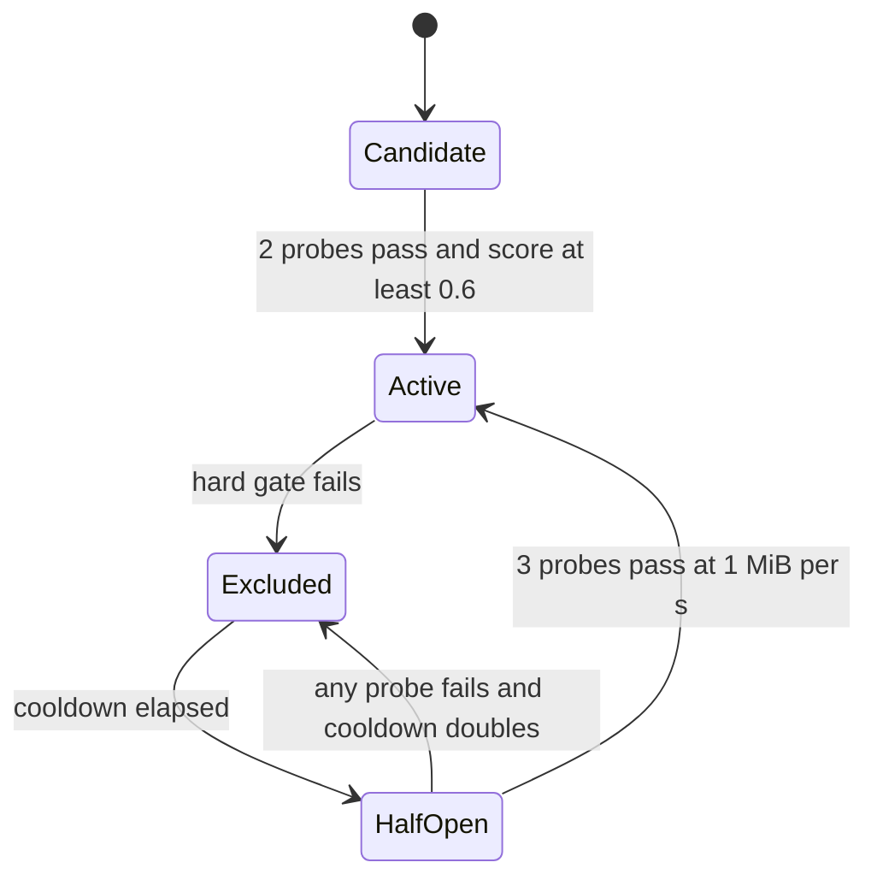

# Multi-Carrier Intelligence Design

Status: DESIGN ONLY (architect). No code, configuration, or host was changed or contacted.
Branch: fix/complete-up-read-implementation (origin tip includes d976957, not re-verified in this session; git was not executed).
Document date: 2026-10-09 (from environment).
Units: "1 MB/s" in the requirements is interpreted as 1 MiB/s = 1 048 576 bytes/s (conservative). Decision D11 asks whether decimal MB is intended.

Evidence labels used throughout:
- [V] Verified in this repository by reading code or docs during this session.
- [R] Reported in the brief or earlier verified runs (not re-measured here).
- [A] Assumption or knowledge-based claim not verified against live sources. Must be verified before the phase that depends on it.

---

## 1. Executive summary

- Today the system carries exactly one down carrier and one up carrier. The node holds one slot per direction, and both splitters reject a second carrier explicitly [V]. Multi-carrier support therefore requires changes in pkg/node, both binaries' accept/dial paths, the rebind wire format, and config. It does not require changes to the mux framing or the session model.
- The node boundary is already transport-agnostic: InstallUp and InstallDown accept any io.ReadWriteCloser plus a bufio.Reader [V]. Transport specifics live only in the binaries' dial/accept code. The abstraction work (Phase 1) is therefore mostly a registry and an adapter contract, not a rewrite.
- Carrier health is a measured model, not a ping. The score is built from delivered goodput, transfer success rate, stall rate, time-to-first-byte, and reset/flap stability. Active probes are bounded by an explicit byte budget. TCP connect RTT is recorded for diagnostics and is given zero weight in the score.
- Selection is deterministic: hard gates, then a score with hysteresis (margin plus consecutive evaluations plus minimum dwell), then exponential cooldown with half-open readmission. Streams are pinned to their carrier for life and move only through the existing grace/rebind path on carrier loss.
- Recommended first two tunnels to deploy now: (1) the existing VLESS+Reality TCP down path as Carrier A (baseline, already deployed); (2) a second VLESS+Reality instance as Carrier B on a different port and a different, TLS 1.3-compliant SNI, reusing the pinned Xray stack. Rationale in section 9. Note that both still share one Germany IP, which is the main correlated-failure risk (decision D2).
- Phased plan: Phase 0 baseline and external Iran measurement, Phase 1 abstraction with unchanged behavior, Phase 2 second carrier plus static failover, Phase 3 scoring/probes/policy/dashboard, Phase 4 UDP/QUIC experiment on a separate host, Phase 5 optional striping. Each phase has an explicit gate and rollback.
- Thirteen user decisions are required before Phase 2 (section 12). Probing from Iran and any production-host change need explicit approval.

---

## 2. Current state (verified) and gaps

| Area | Current behavior | Evidence |
|---|---|---|
| Down carrier, Germany side | Single carrier accepted; second carrier closed with "already connected" | [`cmd/germany-splitter/main.go`](../cmd/germany-splitter/main.go:463) (lines 463-469) |
| Down carrier accept loop | Bounded unauthenticated-handshake gate, default 16 | [`cmd/germany-splitter/main.go`](../cmd/germany-splitter/main.go:379) (379-453) |
| Single-carrier test | Test asserts a complete second carrier is rejected; must be intentionally changed in Phase 2 | [`cmd/germany-splitter/down_carrier_auth_limit_test.go`](../cmd/germany-splitter/down_carrier_auth_limit_test.go:273) (273-305) |
| Up carrier, Iran side | Second WS upgrade returns 409 when UpReady() | [`cmd/iran-splitter/main.go`](../cmd/iran-splitter/main.go:350) (350-355) |
| Down dial loop, Iran side | Single DownCarrierAddr dialer with backoff | [`cmd/iran-splitter/main.go`](../cmd/iran-splitter/main.go:434) (434-473) |
| Down address config key | down.carrier.addr | [`cmd/splitterctl/main.go`](../cmd/splitterctl/main.go:489) |
| Node carrier handle | carrierHandle holds one *mux.CarrierConn and a generation | [`pkg/node/node.go`](../pkg/node/node.go:206) (206-208) |
| Node slot per direction | current(dir) returns one handle per direction | [`pkg/node/node.go`](../pkg/node/node.go:417) |
| Ready predicates | UpReady and DownReady report a single installed carrier | [`pkg/node/node.go`](../pkg/node/node.go:406) (406-416) |
| Node install API | InstallUp and InstallDown take io.ReadWriteCloser and bufio.Reader (transport-agnostic) | [`pkg/node/node.go`](../pkg/node/node.go:513) (513-522) |
| Rebind | Attachments carry direction and grace window; rebind is driven per direction | [`pkg/node/node.go`](../pkg/node/node.go:733), [`pkg/node/node.go`](../pkg/node/node.go:1079) |
| Session attachments | UpAtt and DownAtt per direction; StreamIDUp and StreamIDDown informational | [`pkg/session/session.go`](../pkg/session/session.go:311) (311-320) |
| Rebind wire format v1 | 1 version byte, 16-byte SessionID, 8-byte sender generation (25 bytes); unknown version dropped | [`pkg/session/attachment.go`](../pkg/session/attachment.go:285) (285-315) |
| Carrier liveness and queues | CarrierConn Register, WriteFrame, liveness, Ready, QueueStats exist | [`pkg/mux/carrier.go`](../pkg/mux/carrier.go:53) (53, 673, 765, 794, 850, 938) |
| Grace window | Default 5 s per direction, Config.Grace | [`pkg/node/node.go`](../pkg/node/node.go:79) (79-82) |
| Dashboard port collision | Dashboard TLS port 8443 is reserved by the installer design | [`plans/oneclick-installer-design.md`](oneclick-installer-design.md:305) (305) |
| Reality dest rule | Dest is SNI plus port 443, TLS 1.3 required | [`plans/t3-design.md`](t3-design.md:142) (142), [`plans/t4-design.md`](t4-design.md:174) (174) |

Gaps:
- G-1: the node cannot hold more than one carrier per direction.
- G-2: rebind v1 has no carrier identity; a session cannot name the carrier it is moving to.
- G-3: no per-carrier measurement surface beyond QueueStats and liveness.
- G-4: no synthetic probe path exists in-tunnel.
- G-5: Iran-side Xray consumer is operator-managed; a second inbound/outbound requires operator config changes (decision D4).
- G-6: the prior multi-transport download plan referenced by the brief was not found under plans/ during this session (searched plans/ by name and content). This design takes its architecture from the brief. If that plan exists elsewhere, reconcile before Phase 1.
- Statement check: the brief places the Iran dial target at :10802. The code dials the configured down.carrier.addr. Whether that address is the local Xray consumer inbound (direction as in section 3) must be confirmed in [`cmd/iran-splitter/main.go`](../cmd/iran-splitter/main.go:448) before Phase 2. [A]

---

## 3. Requirements traceability

| Req | Where addressed |
|---|---|
| R1 each carrier at least 1 MiB/s | Sections 6.6 (SLA flag), 10 (Phase 0 and external gates) |
| R2 health not based on ping or connect delay | Section 6 (scoring; connect RTT weight 0) |
| R3 transport-agnostic, multi-instance | Sections 4, 5 |
| R4 landscape research | Section 8 |
| R5 intelligence management | Section 7 |
| R6 phased plan with gates | Section 10 |
| R7 user decisions | Section 12 |

---

## 4. Transport-agnostic architecture

### 4.1 Core concepts

- Carrier: one authenticated transport connection carrying mux frames in one direction. Identified by CarrierID.
- CarrierID: stable string, `<direction>.<family>.<instance>`, for example `down.reality.a` and `down.reality.b`, `up.ws-cdn.a`. It is not a secret and may appear in logs and the dashboard.
- Carrier spec (config, no secrets in logs): direction, family, local or remote endpoint, SNI or host header (public), instance label, priority hint, and a config fingerprint (hash of public params). Secret material (tunnel secret, Reality private key) stays in existing secret paths and is never part of the spec print.
- Adapter: the only code that knows a transport family. Contract:
  - Dial or Accept produces an authenticated io.ReadWriteCloser plus bufio.Reader, then calls the node install API.
  - Reports dial result, auth result, and transport-level errors to the registry.
  - Never makes policy decisions.
- Registry (in pkg/node): holds CarrierID to carrierHandle for each direction, lifecycle state (section 6.5), and metrics.
- Policy engine (in pkg/node): picks carriers for new streams and triggers failover. Pure function of a metrics snapshot and clock input, so it is deterministic under test.

### 4.2 Node changes (Phase 1 and 2)

- Replace current(dir) with a per-direction map keyed by CarrierID. Keep UpReady and DownReady as "at least one carrier installed" wrappers for existing callers.
- Install is keyed by CarrierID. A second install with the same ID replaces the first (current behavior, scoped per ID).
- Generation is per (direction, CarrierID). Each attachment records the generation of the carrier it is bound to.
- Stream IDs stay process-wide (per brief). Verify allocation sites near [`pkg/node/node.go`](../pkg/node/node.go:1079) before Phase 2. [A]

### 4.3 Binary changes (Phase 2)

- Germany: one down listener per carrier instance (loopback port per instance, for example 127.0.0.1:9002 and 127.0.0.1:9003). The listener port is the trust-free routing key: the carrier arrives from a known Reality instance. Each listener's acceptor installs into its own CarrierID. The DownReady single-carrier rule becomes a per-ID rule.
- Germany: the bounded handshake gate stays global (one budget across listeners).
- Iran: one down dialer goroutine per configured carrier instance, each with its own backoff (existing backoff package). Iran up side: see decision D5.
- Config: new list form for down carriers, with a backward-compatible single-value form. Single-value config must produce the identical single-carrier behavior (golden test).

### 4.4 Rebind protocol v2 (Phase 2)

- Rebind v1 (25 bytes, version 1) stays decodable. v2 adds a carrier identifier and keeps the generation: version byte, SessionID, CarrierID length and bytes (bounded, for example at most 32 bytes), sender generation.
- Capability negotiation: a peer sends v2 only after the other side advertises v2 support during the carrier auth handshake. Mixed-version pairs fall back to v1 single-carrier behavior. This requires a decision (D9) because it is the one wire change in the design.

---

## 5. Multi-instance model (same family, different ports or SNI)

Instances are independent carriers of the same or different families. Each instance has:
- a local listener on Germany (loopback) or dial target on Iran,
- a public port (Reality) or CDN path (WS),
- an SNI or host header (public),
- a Reality keypair (per instance, generated by the existing keygen path [V] at [`internal/xray/keygen.go`](../internal/xray/keygen.go:67)) or a separate WS path.

Rules:
- Every Reality instance needs its own TLS 1.3 dest per SNI. The existing preflight rule applies per instance [V] ([`plans/t4-design.md`](t4-design.md:174)).
- Germany's xray-germany config gets a second VLESS+Reality inbound for instance b, whose routing points to its own loopback listener (127.0.0.1:9003). This requires extending the T3 renderer in internal/xray (new inbound and routing rule) and is a Phase 2 work item. It is not covered by the current T3 golden files [V] ([`plans/t3-design.md`](t3-design.md:14)).
- Do not reuse port 8443 for Reality. It is reserved for dashboard TLS in the installer design [V] ([`plans/oneclick-installer-design.md`](oneclick-installer-design.md:305)).
- Keypairs and UUIDs are per instance. Sharing a UUID across instances is possible but reduces revocation granularity; decision left to the user (D3).
- Iran's xray-consumer config gets one local inbound and one outbound per Reality instance (local ports 10802 and 10803 proposed). This is operator-managed (D4).

Example plan (values to be confirmed; no secrets):

| Instance | Germany public port | Germany loopback listener | Iran local port | SNI | Status |
|---|---|---|---|---|---|
| down.reality.a | 443 | 127.0.0.1:9002 | 10802 | existing | deployed [V] |
| down.reality.b | 2053 or 2083 (proposed, D3) | 127.0.0.1:9003 | 10803 | new TLS 1.3 domain (user chooses, D3) | proposed |
| up.ws-cdn.a | existing CDN domain, /upload | n/a | n/a | existing | deployed [V] |
| up.ws-cdn.b | decision D5 | n/a | n/a | decision D5 | not decided |

Physical diversity: instances a and b on one Germany IP share IP-level blocking. Phase 2 accepts this as a known limitation; a second Germany host is decision D2.

---

## 6. Carrier health model

### 6.1 Principles

- Score only measured application-level outcomes: bytes actually delivered end to end, and whether streams complete.
- Connect RTT and ICMP ping are logged for diagnostics. Their score weight is 0 and they cannot promote or demote a carrier.
- Every decision uses both passive (live traffic) and active (bounded probe) evidence. Passive-only is allowed when probes are exhausted, but the score then decays toward unknown.

### 6.2 Metrics per CarrierID per direction

| Metric | Definition | Source |
|---|---|---|
| Goodput | Application bytes delivered to the consumer per second, EWMA with 60 s half-life, sampled every 1 s | Mux delivery counters (new counter, Phase 3) |
| Probe goodput | Bytes/s of the last successful active probe, EWMA with 10 min half-life | Probe service (section 6.4) |
| Stream success | (ok + 1) / (attempts + 2) over the last 50 streams (Laplace smoothed) | Session outcome |
| Stall | An interval of at least 5 s with pending bytes and zero delivered bytes | Mux delivery counters |
| Stall rate | Stalls per 100 MiB delivered | Derived |
| TTFB | Stream open to first DATA byte consumed; p50 over last 50 streams | Session timing |
| Reset | Carrier loss not caused by local shutdown (read error, liveness timeout, peer close with error) | Node loss path [V] (pkg/node/node.go loss sweep near line 699) |
| Flap | Carrier transitions Up to Down to Up within a window | Registry |
| Auth failure | Failed carrier auth in the last 60 s | Adapter |
| Connect RTT | TCP connect time (diagnostics only, weight 0) | Adapter |

### 6.3 Score

Units: goodput in MiB/s. Baseline TTFB comes from Phase 0 per family.

```text
G = min(1, goodput_ewma / 1 MiB_per_s)            weight 0.35
S = (ok + 1) / (attempts + 2)                      weight 0.25
N = clamp(1 - stall_rate_per_100MiB / 4, 0, 1)     weight 0.15
T = clamp(1 - (ttfb_p50 / ttfb_baseline - 1.5) / 2.5, 0, 1)   weight 0.10
R = 1 - min(1, resets_per_10min / 3)               weight 0.15

score = 0.35*G + 0.25*S + 0.15*N + 0.10*T + 0.15*R     (range 0 to 1)
```

Notes:
- T is 1 when TTFB p50 is at most 1.5 times baseline, and falls to 0 at 4 times baseline.
- If a metric has fewer than its minimum sample count (streams 10, bytes 4 MiB), it uses the probe value or the neutral value 0.5. Neutral values are logged.
- The weights are a starting point and must be tuned in Phase 3 against recorded traces, not by feel.

Hard gates (score forced to 0, state Excluded, bypass hysteresis):
- H1: two consecutive probe failures.
- H2: three or more flaps in 10 minutes.
- H3: auth failure within 60 s.
- H4: zero delivered bytes for 30 s while pending bytes exist.

### 6.4 Active probing (bounded cost)

- Probe type: a synthetic transfer over the same mux framing, using a probe stream served by the Germany splitter (in-tunnel, authenticated by the carrier auth; no public endpoint). Direction-specific: down probes pull bytes from Germany; up probes push bytes to Germany. Probes use the same carrier they test; they are not sent over another carrier.
- Quick probe: 128 KiB, every 5 minutes, only when passive goodput is below 0.2 MiB/s (idle carrier).
- Full probe: 2 MiB, every 60 minutes per carrier, and once on each admission.
- Daily cap: 96 MiB of probe bytes per carrier per day (default, D7). When the cap is reached, probes stop until the day rolls over; passive scoring continues.
- Yield: probes are suspended while the carrier carries real traffic above 0.2 MiB/s.
- Probe results feed H1 and the probe goodput EWMA. A probe passes when it completes within its deadline and its goodput is at least the SLA floor (1 MiB/s for full probes; quick probes use 0.5 MiB/s, to avoid false failures on a 128 KiB sample).

Budget arithmetic (default): quick probes at idle maximum are 128 KiB times 288 = 36 MiB/day; full probes are 2 MiB times 24 = 48 MiB/day; total 84 MiB/day, under the 96 MiB/day cap. Egress cost is not verified against the provider's pricing [A]; decision D7.

### 6.5 Lifecycle, hysteresis, cooldown, readmission

States: Candidate, Active, Excluded, HalfOpen.



Parameters:
- Evaluation interval: 10 s.
- Switch rule (hysteresis): the primary changes only if a challenger's score is at least the incumbent's score plus 0.10 for 3 consecutive evaluations, and at least 60 s have passed since the last switch.
- Hard-gate exclusion of the incumbent is immediate and bypasses hysteresis (failover).
- Cooldown: 30 s after the first exclusion, doubling per consecutive exclusion, capped at 15 minutes. The exclusion counter resets after 30 minutes of Active health.
- Readmission (half-open): one probe per cooldown expiry; 3 consecutive full probes (2 MiB) at the 1 MiB/s SLA floor return the carrier to Active with its counter reset. Quick probes (128 KiB) never decide readmission; their 0.5 MiB/s floor applies only to Active-state health.
- Admission to Active requires 2 consecutive passes and score at least 0.6.

SLA flag: a carrier is "meets SLA" when its probe goodput EWMA is at least 1 MiB/s in the given direction. The dashboard shows it per direction (R1).

### 6.6 R1 check

Per-carrier SLA is tested externally from Iran (section 10, gates G0, G2, G3, G5). The internal probe checks the same floor, but the internal numbers come from the Germany-Iran path and must not replace the external measurement.

---

## 7. Intelligence management

### 7.1 Selection for new streams (deterministic)

- Eligible set: carriers in Active state for the direction.
- Phase 2 policy: static priority list from config. The first Active carrier in order is primary; others are standby. Fully deterministic.
- Phase 3 policy: top K Active carriers by score (K = 2 default, D13). New streams are assigned by smooth weighted round robin with weights round(100 * score squared). Tie-break by CarrierID lexical order. Given the same metric snapshot and the same stream sequence, the assignment is identical (testable).
- Primary/standby hysteresis (section 6.5) applies to the ordering used by the round robin.

### 7.2 Per-stream pinning

- A stream is pinned to the carrier that carried its open. It is never moved while that carrier is healthy, because moving a live stream risks reordering and duplicate delivery.
- On carrier loss, the affected session enters the existing grace window (default 5 s) and re-attaches via rebind to the best Active carrier with a new generation (section 4.4). If no carrier re-attaches within grace, the session closes with the existing carrier-timeout reason [V] ([`pkg/node/node.go`](../pkg/node/node.go:495)).
- Credits and data for a stream are sent on the new carrier only after the peer has registered the stream there. This is the lesson from the earlier flap storm (rebind anchor race); it is a hard invariant with a regression test.

### 7.3 Failover

- Detection: carrier read error, liveness timeout, or H1/H4 gate. Target: detection and exclusion within 5 s on a dead carrier.
- Action: exclude the carrier, move new streams to the next Active carrier immediately, and start the grace-window rebind for affected sessions.
- Recovery: the failed carrier reconnects through its adapter backoff, then enters Candidate or HalfOpen as in section 6.5. It does not carry traffic until admitted.

### 7.4 Striping (Phase 5 only, optional)

- Splitting a single stream across carriers needs per-chunk sequence numbers and a bounded reorder buffer. This is a wire and session change and is out of scope until the Phase 0 and Phase 3 gates show a single carrier cannot reach 1 MiB/s from Iran and aggregate target needs more than one carrier (D10).

### 7.5 Observability

- Per-carrier gauges and counters on the existing metrics surface (pkg/node/metrics.go exists [V]): state, score, G, S, N, T, R components, goodput EWMA, probe goodput, probe bytes used today, flap count, reset count, exclusion reason code, cooldown remaining.
- Dashboard: a carriers table per direction, using the existing dashboard collector and redaction ([`internal/dashboard/redact.go`](../internal/dashboard/redact.go)). Carrier endpoints are shown with secrets stripped; no secret, Reality key, or tunnel secret is ever shown.
- Telemetry names align with [`plans/telemetry-spec.md`](telemetry-spec.md) (to be read in Phase 1 for naming conventions) [A].
- Decision log: every switch, exclusion, and readmission is logged with its reason code and the metric snapshot summary (no secrets).

### 7.6 Pseudo-code (policy tick, every 10 s)

```text
for each direction:
  snapshot = metrics for all carriers
  for each carrier:
    if any hard gate H1..H4: state = Excluded, cooldown = next_cooldown()
    else if state == Excluded and cooldown elapsed: state = HalfOpen
    update score from snapshot (neutral values for missing samples)
  eligible = Active carriers sorted by (score desc, CarrierID asc)
  if primary not in eligible: switch primary to eligible[0] immediately
  else if eligible[0].score >= primary.score + 0.10 for 3 ticks and dwell >= 60 s: switch
  new-stream assignment = smooth WRR over top K eligible
```

---

## 8. Transport landscape (2026)

Research status: the webfetch search tool returned "fetch failed" for all four queries, so no search results were obtained. Direct page fetches were attempted:
- [V-web] Xray-core releases page (github.com/XTLS/Xray-core/releases, fetched 2026-10-09) lists releases through v26.9.30 (08 Sep 2026 and later). The repository pins v26.3.27 [V], so the pin is several minor releases behind. Upgrading the pin is a separate decision and needs its own compatibility check.
- [V-web] The Project X SplitHTTP documentation page (xtls.github.io/en/config/transports/splithttp.html) shows a pointer to "XHTTP: Beyond REALITY", which indicates XHTTP is the successor name for SplitHTTP. The exact XHTTP mode and client support are not verified.
- [FAILED] A webtunnel repository URL and a Hysteria2 documentation URL returned 404. Their claims remain [A].
All other claims in this section are background knowledge marked [A]. Facts about this repository are [V]. A live verification pass for the remaining [A] claims is required before Phase 4 (D12).

Columns: availability in Iran-type censorship; DPI resistance; throughput potential; ops complexity; licensing and maintenance; fit with this codebase; verdict.

| Transport | Availability in Iran-type censorship | DPI resistance | Throughput potential | Ops complexity | License and maintenance | Fit with codebase | Verdict |
|---|---|---|---|---|---|---|---|
| VLESS+Reality over TCP (XTLS-Vision flow) | Deployed here [V] (T3 Reality keygen and config). Widely used in restrictive regions [A]. Blocking mostly IP-level or by specific fingerprints [A] | High against active probing: unauthenticated probes forwarded to real dest [A] | High, bounded by one TCP flow's RTT and loss | Medium (pinned Xray, keypairs, dest preflight) [V] | Xray-core, MPL-2.0 [A]; actively maintained [A] | Native (existing down path) [V] | NOW (instances a and b) |
| VLESS over WebSocket via CDN | Up path already uses WS via Arvan [V]. CDN-fronted WS survives IP blocking but CDN-level throttling possible [A] | Medium to high with real TLS on CDN [A] | Medium; WS framing overhead, CDN per-connection limits [A] | Medium (CDN config, origin Caddy) [V] | Standard; Xray and Caddy maintained [A] | Native for up [V] | NOW (up, existing); second up path D5 |
| VLESS over gRPC via CDN | Less commonly seen recently [A] | Medium | Medium to high (H2 multiplexing) [A] | Medium; needs CDN H2 support [A] | Maintained [A] | Requires new adapter | LATER |
| VLESS over HTTPUpgrade | Simpler HTTP upgrade alternative to WS [A] | Medium | Medium [A] | Low to medium [A] | Maintained in Xray [A] | Requires adapter | LATER (evaluate vs XHTTP) |
| XHTTP (successor to SplitHTTP, Xray) | Designed for CDN-fronted HTTP/2 and HTTP/3 paths; support in the pinned Xray version to be verified [A] | Medium to high (HTTP-shaped traffic) [A] | Medium to high, depends on mode [A] | Medium to high [A] | Maintained in Xray [A] | Requires version check and adapter | LATER, strongest candidate for a second family over CDN, after Phase 2 |
| Hysteria2 (QUIC, UDP) | UDP is frequently throttled or blocked in restrictive regimes [A]. Must be probed from Iran | Medium; QUIC handshake is fingerprintable [A] | High under loss, with aggressive congestion control [A] | Medium (certs or ACME, UDP firewall) [A] | MIT, actively maintained [A] | No adapter; UDP path not in codebase [V] | LATER, Phase 4 experiment only, separate host, D6 |
| TUIC v5 (QUIC) | Same UDP risk as Hysteria2 [A] | Medium [A] | High [A] | Medium [A] | Maintenance status not verified [A] | No adapter [V] | AVOID as first QUIC experiment; revisit |
| Shadowsocks-2022 (AEAD-2022) | Reported blocked in several restrictive networks [A] | Low without a camouflage layer; length and entropy patterns [A] | High | Low [A] | Maintained [A] | No adapter | AVOID as primary |
| ShadowTLS v3 over Shadowsocks | TLS handshake camouflage with a real site [A] | Medium [A] | High [A] | Medium [A] | Maintained [A] | No adapter | AVOID now; LATER only as a camouflage wrapper experiment |
| Trojan (TLS) | Real-domain TLS; overlaps VLESS+TLS [A] | Medium [A] | High [A] | Medium [A] | Maintained [A] | No adapter | AVOID as new family (no clear gain over existing VLESS paths) |
| WireGuard (plain) | Fingerprintable UDP; frequently blocked [A] | Low [A] | High [A] | Low | Stable [A] | No adapter | AVOID |
| AmneziaWG (obfuscated WireGuard) | UDP risk as above; obfuscation changes header and junk packets [A] | Medium [A] | High [A] | Medium [A] | Maintained [A] | No adapter | LATER, only as UDP experiment with Phase 4 |
| Naive (HTTP/2 CONNECT proxy) | Browser-like HTTPS traffic via CDN [A] | Medium to high [A] | Medium [A] | Medium; depends on a Caddy forward-proxy plugin whose maintenance status is unverified [A] | Plugin status unverified [A] | Requires Caddy plugin path [V] (Caddy used for origin) | LATER, after plugin status verified |
| obfs4 (Tor pluggable transport) | Reported blocked in Iran in the past [A] | Medium [A] | Low to medium, Tor-limited [A] | Medium [A] | Tor project, maintained [A] | No adapter | AVOID for throughput; fallback research only |
| Snowflake (Tor, WebRTC) | Volunteer-dependent proxies [A] | Medium [A] | Low; unpredictable [A] | Low for user, high dependency [A] | Tor project [A] | No adapter | AVOID (cannot meet SLA) |
| webtunnel (Tor pluggable transport) | HTTPS and WebSocket imitation, newer [A] | Medium [A] | Low to medium, Tor-limited [A] | Medium [A] | Tor project [A] | No adapter | LATER, fallback research only |
| MASQUE CONNECT-UDP (RFC 9298) and CONNECT-IP (RFC 9484) over HTTP/3 | Standards-based HTTP/3 camouflage; UDP reachability risk [A] | Medium to high [A] | Medium to high [A] | High; proxy ecosystem young for Go [A] | IETF standards [A]; implementation maturity varies [A] | No adapter | LATER, Phase 4 alternative to Hysteria2 |
| MPTCP | Middleboxes may strip the option [A]; client support uneven, Windows limited [A] | Not applicable (transport) | Potential aggregation at transport layer [A] | High [A] | Kernel feature [A] | Not app-layer; not a carrier adapter | LATER, experiment only |
| Commercial overlays (Psiphon, Lantern and similar) | Varies [A] | Varies | Varies | Low for user | Third-party trust and operation | Out of scope | AVOID (third-party trust boundary) |

Verdict summary:
- NOW: VLESS+Reality TCP (two instances); VLESS+WS over CDN for up (existing).
- NEXT (after Phase 2): XHTTP over CDN as a second family for download; HTTPUpgrade as a fallback candidate.
- LATER (Phase 4, separate host, consent): one QUIC experiment (Hysteria2 or MASQUE), gated on UDP probing from Iran.
- AVOID: plain WireGuard, Shadowsocks-2022 as primary, Trojan as a new family, Tor transports for throughput, commercial overlays.

### 8.1 Probes required from Iran (external vantage)

| ID | Probe | Purpose | Gate |
|---|---|---|---|
| P1 | TCP connect to each candidate endpoint (443, 2053 or 2083, CDN 443) with reset and timeout classification | Port and IP reachability | G0 |
| P2 | TLS 1.3 handshake per SNI candidate from Iran | SNI-level blocking | G0 |
| P3 | Full carrier auth round trip, 50 attempts per instance | Auth success under censorship | G0 |
| P4 | 20 MiB down and up transfer per carrier, 10 runs each; record p10, p50, TTFB, stalls | R1 SLA | G0, G2, G3 |
| P5 | Throughput profile after 5 MiB and after 50 MiB | Volume throttling detection | G0 |
| P6 | 30-minute soak per carrier; resets, flaps | Stability (R, H2) | G3 |
| P7 | UDP reachability and 20 MiB QUIC transfer to a separate host | Phase 4 viability | G4 |
| P8 | Upload path via CDN WS with same transfer profile | Up SLA | G2 |

Run location: the operator runs P1–P8 from an Iran vantage, or explicitly authorizes the agent to do so (D8). Results must be redacted of secrets and endpoints the operator considers sensitive.

---

## 9. Recommended first two tunnels to deploy now

1. Carrier A: VLESS+Reality over TCP on port 443 (existing down path, instance down.reality.a).
   - Rationale: already deployed, verified in this repo [V], and its measured lab performance is already above 1 MiB/s [R]. Using it as the baseline isolates the effect of multi-carrier changes from transport changes.
2. Carrier B: a second VLESS+Reality instance on a different port (2053 or 2083, D3) and a different TLS 1.3 SNI, using the same pinned Xray stack and the existing keygen and dest preflight.
   - Rationale: same protocol and code path, so the first multi-carrier increment is a registry and routing change, not a new protocol. It exercises the multi-instance requirement (R3) and gives port-level and SNI-level diversity. Its main limit is the shared Germany IP, which is accepted for Phase 2 and must be revisited (D2).
   - Alternative considered: XHTTP over CDN as the second carrier. Rejected for the first step because its Xray version support and Arvan compatibility are unverified [A], and it would add an adapter plus a CDN dependency at once.

Up direction: the existing WS-over-CDN carrier remains the only up carrier until D5 is decided. Adding a second up carrier is a separate increment.

---

## 10. Phased implementation plan with gates and rollback

Each phase ends with a gate. A gate failure stops the phase; rollback restores the previous phase's behavior.

### Phase 0: baseline and feasibility (no production code change)

Work:
- Record current single-carrier metrics from Iran for down and up: 20 MiB transfers, 10 runs each, with P1–P5 from section 8.1 for instance a.
- Run P1 and P2 for the proposed instance b endpoint and SNI before any change.
- Define the external test harness (new script under scripts/, to be built in Code mode). It must redact secrets and must keep management SSH routing outside the tunnel under test.
- Confirm the Iran dial direction (section 2, statement check) and the Iran Xray consumer config shape.

Acceptance:
- A1: Instance a from Iran: p10 of 20 runs at least 1 MiB/s per direction (SLA statistic per D11); 0 failed transfers in 20 runs.
- A2: Instance b endpoint P1 and P2 pass from Iran, or the SNI and port are rejected and replaced before Phase 1.
- A3: Baseline TTFB p50 recorded per direction (feeds T in the score).

Gate G0: A1, A2, A3 pass. If instance a is below 1 MiB/s from Iran, add a tuning or striping decision (D10) before Phase 2.
Rollback: none needed (read-only).

### Phase 1: abstraction with unchanged behavior

Work:
- Introduce CarrierID, carrier spec, adapter interface, and registry with exactly one entry per direction.
- Route existing install calls through the registry. No new config keys are required; single-value config is unchanged.
- Keep UpReady and DownReady semantics.

Acceptance:
- U1: all existing Go tests pass on Linux (including cmd/germany-splitter/down_carrier_auth_limit_test.go and cmd/iran-splitter/ws_test.go).
- U2: generated configs and golden files are byte-identical (xray and systemd golden tests [V]).
- U3: 30-minute external soak of the unchanged production topology shows no behavior difference against the Phase 0 baseline.

Gate G1: U1, U2, U3 pass.
Rollback: revert the single Phase 1 commit set.

#### Phase 1 completion note (2026-10-10, subtask G1)

Completed on branch fix/complete-up-read-implementation at local 8bb4af6. Introduced the
transport abstraction (CarrierID, CarrierDescriptor, per-direction one-entry
carrierRegistry) in pkg/node/carrier_registry.go and routed the Node's
install/ready/teardown paths through the registry (n.upReg / n.downReg are now the
authoritative handle storage; the legacy raw n.up / n.down fields were removed).
Registry unit tests added in pkg/node/carrier_registry_test.go (registration,
lookup, duplicate-ID rejection, removal, generation increment on replacement,
single-carrier-only invariant via the structurally-absent second slot).

Wire format, frame payloads, rebind semantics, config env names, and metric
names/values are unchanged; the Node's node-global generation counter (n.genSeq)
is preserved so rebind generations stay lockstep. Germany's DownReady()
single-carrier rejection and Iran's 409 for a second up carrier are unchanged.
Per-carrier metric/label plumbing (item 4) was SKIPPED: it would require new
metric labels on the single-carrier case and thus risk changing existing metric
names/values, so it is deferred to Phase 3.

Gate G1 results:
- U1 (Go tests, Windows host 10.10): go build ./... OK; go vet ./... OK;
  go test ./... PASS for all 18 packages (cmd/germany-splitter, cmd/iran-splitter,
  cmd/splitterctl, integration, internal/*, pkg/mux, pkg/node, pkg/session).
- Golden tests (U2): internal/xray and internal/systemd golden tests pass with
  golden files unmodified (byte-identical).
- Installer harness: install-oneclick.test.sh via Git Bash = PASS=74 FAIL=0.
- Registry unit tests: 11/11 pass.
- Single-carrier rejection tests: cmd/germany-splitter
  TestDownCarrierDownReadyUnchanged and TestDownCarrierNormalAuth pass; the Iran
  409 path is code-unchanged.
- Linux -race: UNVERIFIED. Windows host cannot run -race (0xc0000139); the
  Germany host scratch-copy approach (git archive from 8bb4af6 → /root/g1-race-scratch
  → go test -race ./pkg/... ./internal/... ./cmd/...) could not be executed because
  the Phase 1 changes are uncommitted (git archive exports only the last commit, which
  is the docs commit 8bb4af6, not the registry code). No host service was touched; the
  /root/g1-race-scratch copy was created and removed. The race gate must be re-run on
  Linux CI after the Phase 1 change is committed.
- U3 (30-minute external soak): NOT YET RUN — requires the Phase 0 baseline and an
  operator-approved production-topology soak; not part of this subtask.

Status: Phase 1 code complete, NOT committed, NOT pushed. Pending: commit + Linux
-race re-run + U3 external soak to fully close Gate G1.

### Phase 2: second carrier and static failover

Work:
- Per-CarrierID slots in pkg/node.
- Germany: one loopback listener per down instance (127.0.0.1:9002 and 127.0.0.1:9003); per-ID DownReady rule. Update the existing single-carrier test intentionally to the new per-ID rule (its current assertion is at [`cmd/germany-splitter/down_carrier_auth_limit_test.go`](../cmd/germany-splitter/down_carrier_auth_limit_test.go:273)).
- Iran: one dialer per configured down instance.
- Rebind v2 with capability negotiation (D9); v1 path kept.
- Static priority policy (section 7.1 Phase 2 policy).
- Iran xray-consumer config with two inbounds and outbounds (D4).

Acceptance:
- F1 (in-process, Linux, using testutil/mempipe.go): two carriers; kill primary during a 20 MiB transfer; sha256 identical; re-attach within grace.
- F2 (regression): a second carrier with the same CarrierID replaces the first; a second carrier with a different CarrierID is accepted.
- F3 (regression): no credits sent for a stream before peer registration on the new carrier (flap-storm regression test).
- F4 (mixed version): v2 peer with v1 peer falls back to single-carrier behavior and does not flap.
- F5 (external, from Iran): each instance meets section 10 Phase 0 A1; failover of a killed primary completes within 5 s; 20 induced failovers with 0 corruption.
- F6 (external, mixed): upgrade one side only; no flap storm over 30 minutes.

Gate G2: F1–F6 pass.
Rollback: set config back to the single-value down carrier form; the code path for one carrier is retained and covered by the golden test. If the binary must be reverted, revert the Phase 2 commit set. The Iran xray-consumer change is rolled back from its pre-change config backup (operator-managed, D4).

### Phase 3: health scoring, probes, hysteresis, policy, dashboard

Work:
- Mux delivery counters (goodput, stalls, TTFB).
- In-tunnel probe service on Germany and probe scheduler on both sides; budget enforcement.
- Score, gates H1–H4, hysteresis, cooldown, readmission (section 6).
- Smooth WRR for top-K new-stream assignment (section 7.1).
- Metrics and dashboard carriers table (section 7.5).
- Trace-based tuning of weights, using recorded traces from Phase 2 external runs.

Acceptance:
- S1: unit tests for score (table-driven, deterministic), gates, hysteresis (no switch on noise below margin), cooldown doubling and cap, and readmission.
- S2: fault-injection simulation: noisy score input with 0.05 amplitude produces at most one switch per 5 minutes.
- S3: probe budget never exceeds 96 MiB/day per carrier in a 24-hour simulated run.
- S4: connect RTT changes alone (injected) do not change the selected carrier (proves R2).
- S5 (external): 2-hour Iran soak across both instances; each direction meets the 1 MiB/s floor for at least p10 of transfers; 0 flap storms; probe byte total within budget.
- S6: dashboard shows state, score components, and exclusion reasons; redaction test shows no secret or private key in output.

Gate G3: S1–S6 pass.
Rollback: set policy to static (Phase 2 priority) through config; the scoring code path stays off.

### Phase 4: UDP or QUIC experiment (only if D6 approves)

Work:
- Separate host (D2 decision), not in the production path.
- Probes P7 and live verification of section 8 facts (D12).
- One candidate only: Hysteria2 or MASQUE CONNECT-UDP.

Acceptance:
- Q1: P7 from Iran: UDP reachable; 20 MiB transfer in 10 runs with p10 at least 1 MiB/s.
- Q2: the experiment carrier implements the same adapter contract and passes F-series tests in isolation.

Gate G4: Q1 and Q2 pass and the operator approves promotion. Otherwise stop; no default changes.
Rollback: stop and remove the experiment host. Nothing in the production path changes.

### Phase 5: striping (optional, only if D10 approves)

Work:
- Per-chunk sequence numbers, bounded reorder buffer, per-stream opt-in flag.

Acceptance:
- T1: correctness under injected reorder and loss (randomized tests with fixed seeds).
- T2: memory bound on reorder buffer under adversarial reorder.
- T3 (external): two carriers striped achieve at least 1.6 times single-carrier goodput from Iran, median over 10 runs.

Gate G5: T1–T3 pass.
Rollback: per-stream flag off; default remains pinned streams.

---

## 11. Risks and standing constraints

- Flap storm from credits sent before peer registration (verified lesson). Regression tests F3 and S-series are mandatory.
- Full-tunnel VPN (WARP) locked SSH out in an earlier run. Any external test must keep management SSH routed outside the tunnel under test.
- Windows -race is unusable in this project. Race tests run on Linux CI only.
- Production hosts: Germany 91.107.152.1 (SSH key path ssh/hetzner_key) and Iran 188.121.111.122. No change to either host is part of this design. Any action on them requires approval.
- Secrets: tunnel secret, Reality private key, and UUID-bearing config never appear in logs, probe output, dashboard, or the design documents. Probe harness output is redacted.
- Correlated blocking: two Reality instances on one IP share IP-level risk (D2).
- Operator-managed Iran xray-consumer drift: changes need a rendered config, run -test gate, and a backup for rollback (D4).
- Probe detectability: probes use the same mux framing inside the same carrier, so they add no new wire signature. Probe timing must be jittered to avoid a fixed-period pattern.
- Dashboard exposure: read-only, existing auth and redaction.
- Rebind v2 mixed-version window: capability negotiation with v1 fallback (F4).
- UDP experiments can trigger UDP blocking that affects other services on the same host (Phase 4 separate host).

---

## 12. Decisions the user must make

Each decision has a recommended default. Phase 2 cannot start until D1, D3, D4, D5, D9 are answered.

| ID | Decision | Options | Recommended default |
|---|---|---|---|
| D1 | Tunnel families to add first | (a) second VLESS+Reality instance; (b) XHTTP over CDN; (c) both in sequence | (a) now, (b) after Phase 2 |
| D2 | Physical diversity for instance b | (a) same Germany IP; (b) second Germany host (extra server cost) | (a) for Phase 2; revisit before Phase 4 |
| D3 | Port and SNI plan for instance b | Port 2053 or 2083 (not 8443); SNI domain list chosen by user, each must pass TLS 1.3 dest check | Port 2053; SNI chosen by user |
| D4 | Iran operator-managed xray-consumer accepts multiple inbounds and outbounds | Yes with operator-owned rendered config; No (single carrier stays) | Yes, rendered and tested with run -test |
| D5 | Second up carrier | (a) same CDN domain, second path; (b) second CDN domain; (c) none for now | (c) for Phase 2; decide before Phase 3 |
| D6 | UDP and QUIC experiments | Allowed on separate host only; Not allowed | Allowed in Phase 4 on separate host only |
| D7 | Probe byte budget | 96 MiB/day per carrier (default); lower or higher; provider egress cost acceptable | 96 MiB/day |
| D8 | Authorization for external Iran probing | Operator runs P1–P8; agent may run them with stated credentials path; Not authorized | Operator runs; agent designs harness |
| D9 | Rebind v2 with capability negotiation (wire change) | Accept v2 with v1 fallback; Keep single carrier only | Accept v2 with fallback |
| D10 | Striping in Phase 5 | Authorized conditionally on G0 or G3 result; Not authorized | Conditional |
| D11 | SLA definition | p10 of transfers at least 1 MiB/s per direction; median only; 1 MiB or 1 MB decimal | p10, MiB |
| D12 | Live web verification of section 8 before Phase 4 | Allowed; Not allowed | Allowed |
| D13 | Active carriers per direction in Phase 3 | 2; 1; 3 | 2 |

---

## 13. Open items and unverified statements

- Prior multi-transport download plan referenced by the brief: not found under plans/ (G-6). Reconcile before Phase 1.
- Commit d976957 on origin: not verified (no git executed).
- Iran dial direction for down carrier: confirm at [`cmd/iran-splitter/main.go`](../cmd/iran-splitter/main.go:448) (section 2).
- Stream ID allocation sites: confirm process-wide scope near [`pkg/node/node.go`](../pkg/node/node.go:1079) (section 4.2).
- Telemetry naming: read plans/telemetry-spec.md before Phase 3 (section 7.5).
- Section 8 landscape facts marked [A]: unverified; D12 covers verification.
- Score weights and thresholds in section 6: starting values, tuned in Phase 3 from traces.
- Egress cost of probe bytes: not verified against provider pricing.
